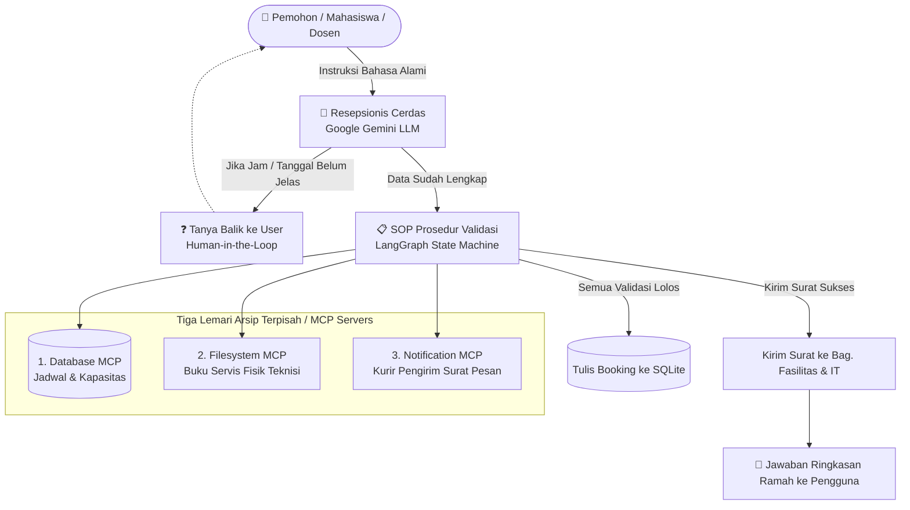

# Panduan Lengkap Arsitektur & Penjelasan Berkas: CampusFlow
**Academic Campus Facility & Event Coordinator**

Dokumen ini ditulis secara khusus untuk menjelaskan secara runtut, jelas, dan bertahap mengenai apa saja yang telah dibangun di proyek **CampusFlow**, peran dari setiap berkas (*file*), serta bagaimana seluruh komponen bekerja sama dari awal hingga akhir.

---

## 1. Konsep Utama: Analogi "Sekretariat Kampus Otomatis"

Sebelum melihat baris kode, bayangkan CampusFlow seperti **Kantor Pengelola Fasilitas & Reservasi Kampus**:



### Mengapa sistem ini dibagi menjadi 3 bagian besar?
1. **Resepsionis (LLM Gemini)**: Bertugas memahami bahasa manusia yang santai. Manusia sering lupa menyebutkan jam atau memakai kata multitafsir ("Selasa depan"). Resepsionis bertugas menangkap maksud pengguna dan bertanya balik jika ada yang kurang.
2. **SOP Prosedur (LangGraph State Machine)**: LLM dilarang langsung menulis ke database sendirian! Jika LLM dibiarkan menulis langsung, ia bisa berhalusinasi atau salah hitung. Oleh karena itu, ada aturan langkah demi langkah yang pasti dan kaku (*deterministik*).
3. **Lemari Arsip Khusus (Server MCP - Model Context Protocol)**: Database, berkas catatan teknisi, dan sistem notifikasi dipisah ke dalam "kamar" masing-masing. Setiap kamar hanya boleh diakses melalui pintu resmi (*tools*).

---

## 2. Struktur Direktori Proyek

Berikut adalah peta struktur berkas di dalam folder `CampusFlow`:

```text
CampusFlow/
├── .env                          <-- Tempat menyimpan API Key rahasia (diabaikan git)
├── .env.example                  <-- Template contoh isi .env
├── requirements.txt              <-- Daftar pustaka Python yang dibutuhkan
├── pytest.ini                    <-- Konfigurasi pengujian otomatis
├── PROJECT_CONTEXT.md            <-- Buku catatan konteks proyek & progres fase
│
├── data/                         <-- Data Mentah Kampus
│   ├── database/
│   │   ├── schema.sql            <-- Rancangan tabel database SQLite
│   │   ├── seed.sql              <-- Data awal realistis gedung, ruang, alat, dan booking
│   │   ├── init_db.py            <-- Skrip pembangun database & uji integritas
│   │   └── campusflow.db         <-- File fisik basis data SQLite lokal
│   └── filesystem/
│       ├── equipment_inventory.txt <-- Daftar nomor seri aset kampus
│       ├── equipment_status.txt    <-- Catatan status operasional peralatan
│       └── maintenance_logs.txt    <-- Log riwayat perbaikan berkala oleh teknisi
│
├── src/                          <-- Kode Sumber Utama Sistem
│   ├── cli.py                    <-- Program demo terminal interaktif
│   │
│   ├── mcp/                      <-- Tiga Server MCP Independen (Fase 4)
│   │   ├── db_server.py          <-- Server MCP Database (Kueri jadwal & transaksi booking)
│   │   ├── fs_server.py          <-- Server MCP Filesystem (Baca log servis & status alat)
│   │   └── notification_server.py<-- Server MCP Notifikasi (Kirim pesan ke departemen)
│   │
│   └── agent/                    <-- Otak & Alur Kerja Agen AI (Fase 5)
│       ├── state.py              <-- Wadah data status yang dibawa sepanjang alur (AgentState)
│       ├── llm.py                <-- Integrasi Google GenAI Gemini & Human-in-the-Loop
│       ├── parser.py             <-- Pengurai teks deterministik berbasis pola (offline fallback)
│       ├── mcp_client.py         <-- Kabel adapter penghubung agen ke server MCP
│       ├── graph.py              <-- Perakitan StateGraph alur kerja LangGraph
│       └── nodes/                <-- Simpul-simpul tugas terisolasi
│           ├── parse_request.py         <-- Simpul penguraian input
│           ├── validate_requirements.py <-- Simpul validasi tanggal/jam dasar
│           ├── check_room.py            <-- Simpul cek bentrok waktu ruangan
│           ├── validate_capacity.py     <-- Simpul cek kapasitas vs peserta
│           ├── check_equipment.py       <-- Simpul cek kelengkapan alat di ruangan
│           ├── authorize_booking.py     <-- Simpul cek kesehatan fisik & anti-kontradiksi
│           ├── create_booking.py        <-- Simpul penulisan transaksi database
│           └── send_notification.py     <-- Simpul pengiriman notifikasi resmi
│
└── tests/                        <-- Pengujian Otomatis (Pytest)
    ├── test_agent_parser.py      <-- Tes unit penguraian teks & tanggal relatif
    ├── test_mcp_integration.py   <-- Tes integrasi 3 server MCP
    └── test_agent_workflow.py    <-- Tes skenario alur kerja LangGraph end-to-end
```

---

## 3. Rincian & Cara Kerja Setiap Berkas

### A. Lapisan Data & Basis Data (`data/`)

1. **[schema.sql](file:///d:/TalentSource/CampusFlow/data/database/schema.sql)**
   * **Tugasnya:** Menentukan struktur cetak biru (*blueprint*) 6 tabel:
     - `buildings` (Gedung), `rooms` (Ruangan), `equipment` (Peralatan seperti proyektor/mic).
     - `room_equipment` (Penetapan alat ke ruangan), `users` (Dosen/Mahasiswa/Staf).
     - `bookings` (Reservasi yang sah), `audit_logs` (Catatan rekaman aksi sistem).
   * **Cara kerjanya:** Dijalankan oleh SQLite dengan mengaktifkan *Foreign Keys* dan indeks pencarian waktu agar pencarian jadwal berlangsung cepat dan tidak terjadi anomali data.

2. **[seed.sql](file:///d:/TalentSource/CampusFlow/data/database/seed.sql)**
   * **Tugasnya:** Mengisi data awal kampus yang realistis.
   * **Isinya:** 3 gedung (Utama, Sains, Teknik), 8 ruangan (Auditorium, Seminar, Lab, dll.), 10 peralatan, dan 5 jadwal pemesanan yang sengaja dibuat untuk menguji skenario bentrok dan skenario sukses.

3. **[data/filesystem/](file:///d:/TalentSource/CampusFlow/data/filesystem/) (`equipment_status.txt`, `maintenance_logs.txt`)**
   * **Tugasnya:** Menyimulasikan sistem berkas catatan fisik teknisi lapangan di dunia nyata.
   * **Tujuan Penting:** Menguji aturan *Evidence-Based Reasoning*. Di database status alat bisa saja tertulis `ACTIVE`, tetapi di berkas teknisi tertulis `FAULTY` (rusak/sedang diservis). Sistem harus mengutamakan bukti fisik dan membatalkan pesanan jika terjadi kontradiksi data.

---

### B. Infrastruktur Server MCP (`src/mcp/`)

Model Context Protocol (MCP) adalah standar protokol resmi agar agen AI dapat mengakses perangkat (*tools*) eksternal secara aman dan terisolasi.

1. **[db_server.py](file:///d:/TalentSource/CampusFlow/src/mcp/db_server.py) (`campusflow-db`)**
   * **Tugasnya:** Menyediakan pintu kueri ke basis data SQLite.
   * **Tools yang disediakan:**
     - `query_room_availability`: Mengecek apakah ada acara lain pada jam & tanggal tersebut.
     - `query_room_capacity`: Mengambil batas kapasitas maksimal ruangan.
     - `query_equipment`: Mencari apakah ada proyektor/sound system di ruangan itu.
     - `create_booking_transactional`: Menulis pemesanan baru secara atomik (ACID). Jika terjadi bentrok di detik terakhir, transaksi langsung dibatalkan (*rollback*).

2. **[fs_server.py](file:///d:/TalentSource/CampusFlow/src/mcp/fs_server.py) (`campusflow-fs`)**
   * **Tugasnya:** Membaca berkas teks catatan operasional kampus secara *read-only*.
   * **Tools yang disediakan:**
     - `get_equipment_status`: Membaca status operasional alat dari file teks.
     - `search_maintenance_log`: Mencari riwayat perbaikan fisik alat berdasarkan nomor serinya.

3. **[notification_server.py](file:///d:/TalentSource/CampusFlow/src/mcp/notification_server.py) (`campusflow-notification`)**
   * **Tugasnya:** Menyimulasikan pengiriman surat/notifikasi resmi antar-departemen kampus.
   * **Tools yang disediakan:**
     - `send_department_notification`: Mengirim data terstruktur ke departemen terkait:
       - `academic_facilities` (Fasilitas Akademik) untuk konfirmasi ruangan.
       - `it_support` (Dukungan TI & Multimedia) untuk persiapan alat/proyektor.

---

### C. Otak Agen AI & Orkestrasi Alur Kerja (`src/agent/`)

1. **[state.py](file:///d:/TalentSource/CampusFlow/src/agent/state.py)**
   * **Tugasnya:** Mendefinisikan `AgentState` (Papan Tulis / *Blackboard* terpusat).
   * **Cara kerjanya:** Ketika alur kerja berjalan dari satu simpul ke simpul berikutnya, objek `state` ini dibawa dan diperbarui. Ia menampung: teks masukan pengguna, tanggal hari ini, field pemesanan yang sudah diurai, hasil validasi ruangan, status alat, nomor referensi booking, jejak audit (*audit trail*), dan pesan klarifikasi.

2. **[llm.py](file:///d:/TalentSource/CampusFlow/src/agent/llm.py)**
   * **Tugasnya:** Menghubungkan CampusFlow ke **Google Gemini** menggunakan Google GenAI SDK resmi.
   * **Fitur Utama:**
     - **Pydantic Structured Output (`LLMBookingExtraction`)**: Memaksa model Gemini menghasilkan data JSON yang selalu rapi dan bertipe data pasti.
     - **Deteksi Human-in-the-Loop**: Jika user tidak menyebutkan jam, atau menyebut "Selasa depan" (yang memiliki dua arti tanggal), Gemini secara otomatis menandai `needs_clarification = True` dan menyusun kalimat tanya ramah dalam Bahasa Indonesia untuk mengonfirmasi ke pengguna.
     - **Resilient Fallback**: Jika server model mengalami lonjakan trafik (*503 demand spike*), sistem otomatis mencoba model alternatif (`gemini-flash-latest`, `gemini-3.8-flash`, `gemini-3.7-flash`) agar tidak pernah macet.

3. **[mcp_client.py](file:///d:/TalentSource/CampusFlow/src/agent/mcp_client.py)**
   * **Tugasnya:** Adapter perantara agar simpul agen LangGraph dapat memanggil alat MCP pada `db_server`, `fs_server`, dan `notification_server` secara *async* dan otomatis mengurai hasil JSON-nya.

4. **Kumpulan Simpul Alur Kerja ([src/agent/nodes/](file:///d:/TalentSource/CampusFlow/src/agent/nodes/))**:
   Setiap berkas di sini adalah **satu langkah pemeriksaan spesifik**:
   * **[parse_request.py](file:///d:/TalentSource/CampusFlow/src/agent/nodes/parse_request.py)**: Membaca teks permintaan atau data hasil Gemini. Jika data belum lengkap, alur langsung berhenti secara aman (*Fail-Fast*).
   * **[validate_requirements.py](file:///d:/TalentSource/CampusFlow/src/agent/nodes/validate_requirements.py)**: Memastikan logika dasar valid (jam mulai < jam selesai, jumlah peserta > 0, tanggal belum lewat dari hari ini).
   * **[check_room.py](file:///d:/TalentSource/CampusFlow/src/agent/nodes/check_room.py)**: Memanggil MCP DB untuk memeriksa apakah ada acara lain di ruangan pada waktu tersebut.
   * **[validate_capacity.py](file:///d:/TalentSource/CampusFlow/src/agent/nodes/validate_capacity.py)**: Memanggil MCP DB untuk membandingkan kapasitas ruangan dengan jumlah peserta.
   * **[check_equipment.py](file:///d:/TalentSource/CampusFlow/src/agent/nodes/check_equipment.py)**: Memanggil MCP DB untuk memeriksa apakah alat yang diminta (misal proyektor) memang terpasang di ruangan tersebut.
   * **[authorize_booking.py](file:///d:/TalentSource/CampusFlow/src/agent/nodes/authorize_booking.py)**: Memanggil MCP Filesystem untuk memeriksa berkas teknisi. Jika ada perbedaan antara DB dan berkas fisik (kontradiksi), alur **dibatalkan seketika (*WORKFLOW_ABORTED*)**.
   * **[create_booking.py](file:///d:/TalentSource/CampusFlow/src/agent/nodes/create_booking.py)**: **Gerbang Terakhir Penulisan**. Hanya boleh menulis ke database jika seluruh validasi di atas berstatus `PASS`. Menghasilkan kode referensi seperti `BK-2026-006`.
   * **[send_notification.py](file:///d:/TalentSource/CampusFlow/src/agent/nodes/send_notification.py)**: Memanggil MCP Notifikasi untuk mengirimkan surat ke Bagian Fasilitas dan Tim IT.

5. **[graph.py](file:///d:/TalentSource/CampusFlow/src/agent/graph.py)**
   * **Tugasnya:** Mengikat seluruh simpul di atas menjadi satu kesatuan alur kerja menggunakan kerangka kerja **LangGraph**.
   * **Prinsip Ponytail**: Alur disusun secara linier dan ringkas (`pipeline = [...]`). Jika ada salah satu simpul yang gagal atau memerlukan klarifikasi, graf langsung menghentikan alur menuju `END` tanpa memboroskan sumber daya komputasi.

---

### D. Antarmuka Pengguna & Pengujian

1. **[src/cli.py](file:///d:/TalentSource/CampusFlow/src/cli.py)**
   * **Tugasnya:** Antarmuka baris perintah (*Command Line Interface*) tempat pengguna dapat mengobrol langsung dengan asisten CampusFlow di terminal.
   * **Alur di CLI:**
     1. Menerima input dari pengguna.
     2. Mengirim ke Gemini untuk dianalisis.
     3. Jika jam kosong atau tanggal ambigu, CLI menampilkan pertanyaan klarifikasi dari Gemini dan menunggu jawaban user.
     4. Jika sudah lengkap, CLI menjalankan `campusflow_agent` (LangGraph).
     5. Menampilkan status akhir, nomor reservasi, tanggapan ramah, dan tabel Jejak Audit (*Audit Trail*).

2. **Pengujian Otomatis ([tests/](file:///d:/TalentSource/CampusFlow/tests/))**
   * **[test_agent_parser.py](file:///d:/TalentSource/CampusFlow/tests/test_agent_parser.py)**: 32 pengujian untuk memastikan parser teks mampu mengenali berbagai variasi bahasa Indonesia dan Inggris.
   * **[test_mcp_integration.py](file:///d:/TalentSource/CampusFlow/tests/test_mcp_integration.py)**: 2 pengujian untuk membuktikan interkoneksi ketiga server MCP.
   * **[test_agent_workflow.py](file:///d:/TalentSource/CampusFlow/tests/test_agent_workflow.py)**: 5 pengujian alur LangGraph end-to-end (sukses penuh, klarifikasi jam hilang, bentrok jadwal, kelebihan kapasitas, dan deteksi kontradiksi alat).

---

## 4. Contoh Nyata: Apa yang Terjadi Saat Anda Mengetik Perintah?

### Skenario A: User Mengetik Lengkap (TC-01)
> *"Pesan auditorium utama untuk workshop AI 100 orang pada 23 September 2026 jam 13:00 sampai 15:00, pastikan proyektor berfungsi."*

1. **`llm.py`** mengekstrak:
   - Ruangan: `AUD-01`
   - Tanggal: `2026-09-23`
   - Jam: `13:00 - 15:00`
   - Peserta: `100`
   - Alat: `['projector']`
   - `needs_clarification`: `False` (karena semua lengkap).
2. **`graph.py`** mulai mengeksekusi simpul:
   - `validate_requirements`: Jam 13:00 < 15:00, peserta 100 > 0 $\rightarrow$ **PASS**.
   - `check_room`: Kueri ke `campusflow-db`, slot 13:00–15:00 kosong $\rightarrow$ **PASS**.
   - `validate_capacity`: Kueri ke `campusflow-db`, kapasitas AUD-01 adalah 300 $\ge$ 100 $\rightarrow$ **PASS**.
   - `check_equipment`: Kueri ke `campusflow-db`, proyektor PRJ-03 terpasang $\rightarrow$ **PASS**.
   - `authorize_booking`: Kueri ke `campusflow-fs`, status PRJ-03 di berkas teknisi adalah `OPERATIONAL` $\rightarrow$ **PASS**.
   - `create_booking`: Validasi sudah 100% PASS, tulis ke tabel `bookings` $\rightarrow$ **Terbit BK-2026-006**.
   - `send_notification`: Kirim ke `academic_facilities` dan `it_support` $\rightarrow$ **SENT**.
3. **`cli.py`** mencetak konfirmasi sukses dan jejak audit lengkap kepada pengguna!

---

### Skenario B: User Lupa Menyebutkan Jam
> *"Pesan auditorium utama untuk workshop AI 100 orang besok."*

1. **`llm.py`** mengekstrak:
   - Ruangan: `AUD-01`, Tanggal: `2026-09-22`, Peserta: `100`.
   - Jam: `None` (hilang!).
   - **`needs_clarification = True`**.
   - Pesan tanya: *"Pemesanan Auditorium Utama untuk workshop AI pada 22 September 2026 telah dicatat. Namun, mohon informasikan jam mulai dan jam selesai acara agar kami dapat memproses reservasi ruangan secara tepat."*
2. **`cli.py`** langsung menampilkan pertanyaan tersebut ke layar dan menunggu jawaban Anda.
3. Database **sama sekali tidak disentuh** sebelum pengguna memberikan jamnya!
