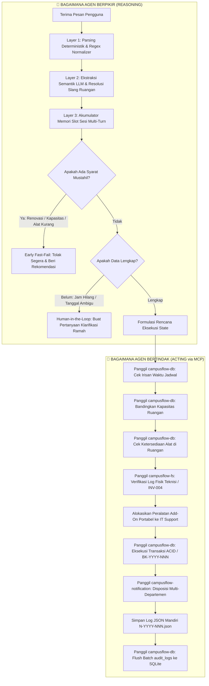
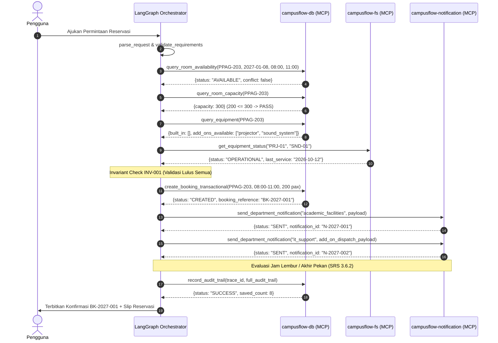

# 🧠 Cara Kerja Agen AI CampusFlow: Berpikir (*Reasoning*) & Bertindak (*Acting*)
> **Academic Facility & Event Coordinator — Autonomous Workflow Agent**  
> *Panduan Teknis Komprehensif untuk Presentasi Proyek*

---

## 1. Ringkasan Eksekutif & Filosofi Desain

Sebagian besar implementasi AI saat ini hanya berupa **"Chatbot Percakapan"** (*Conversational Chatbot*). Chatbot biasa memiliki kelemahan fatal jika diterapkan pada operasional kampus: **rentan halusinasi**, **tidak deterministik**, dan **tidak memiliki wewenang eksekusi yang aman**.

**CampusFlow** dibangun dengan paradigma yang berbeda: **Controlled Autonomous Workflow Agent** (Agen Alur Kerja Otonom Terkendali). 

```
┌────────────────────────────────────────────────────────────────────────┐
│                      ANATOMI AGEN CAMPUSFLOW                          │
├──────────────────┬───────────────────────┬─────────────────────────────┤
│ 🧠 OTAK (Brain)  │ ⚡ SARAF (Nervous)    │ 🦾 TANGAN (Hands / Tools)   │
│ Model LLM        │ LangGraph State       │ 3 Server MCP Terisolasi     │
│ (Google Gemini)  │ Machine               │ (DB, Filesystem, Notif)     │
│ Memahami bahasa, │ Mengatur navigasi     │ Membaca data riil, menulis  │
│ dekomposisi      │ status deterministik  │ transaksi, mengirim         │
│ maksud & nuansa  │ & aturan bisnis pasti │ disposisi resmi             │
└──────────────────┴───────────────────────┴─────────────────────────────┘
```

### Prinsip Utama Sistem:
1. **Pemisahan Persepsi & Logika Bisnis (*Separation of Perception & Business Logic*)**:
   LLM **hanya** digunakan untuk persepsi bahasa manusia (mengurai kalimat santai, slang, dan menyusun teks ramah). Logika bisnis (bentrok jadwal, perhitungan kapasitas, dan penulisan database) dieksekusi secara **100% deterministik** dengan program Python & SQL.
2. **Penalaran Berbasis Bukti Nyata (*Evidence-Based Reasoning*)**:
   Agen dilarang mengambil keputusan berdasarkan asumsi. Status harus dibuktikan dari data faktual melalui protokol **Model Context Protocol (MCP)**.
3. **Invarian Keamanan Mutlak (INV-001)**:
   > *Dilarang keras menulis reservasi ke basis data sebelum seluruh 6 lapis validasi prasyarat dinyatakan lulus 100%.*

---

## 2. Dua Dimensi: Bagaimana Agen Berpikir vs Bertindak

Pola kerja CampusFlow mengadopsi kerangka kerja **ReAct (Reasoning + Acting)** yang diikat dalam **Deterministic State Machine**:



---

## 3. Rincian "Bagaimana Agen Berpikir" (*The Thinking Process*)

Proses berpikir agen dirancang bertingkat (*multi-layered cognitive architecture*) guna memastikan tidak ada data yang terlewat atau terlupakan:

### 1. Dekomposisi Permintaan (*Request Decomposition*)
Ketika pengguna mengetik kalimat majemuk tidak terstruktur:
> *"Mau pinjem ruang mulfung buat yudisium tanggal 8 januari 2027 jam 8 sampe 11, peserta sekitar 200 orang, butuh proyektor, sound system, 230 kursi mhs, 12 kursi sofa dosen"*

Otak agen memecahnya menjadi komponen-komponen mandiri:
* **Entitas Fasilitas**: `room_name: PPAG-203` (memetakan slang *"ruang mulfung"* ke kode resmi).
* **Entitas Temporal**: `booking_date: 2027-01-08`, `start_time: 08:00`, `end_time: 11:00`.
* **Entitas Kapasitas**: `attendee_count: 200`.
* **Entitas Peralatan**: `required_equipment: ["projector", "sound_system"]`.
* **Entitas Logistik Khusus (*Notes*)**: *"mimbar, bendera fakultas sains, 230 kursi mhs, 12 kursi sofa dosen paling depan, prasmanan"*.

### 2. Dual-Layer Hybrid Parsing (Mencegah Delusi / Lupa Konteks)
* **Layer 1 (Regex Lokal Deterministik)**: Bekerja instan (0 milidetik). Pola angka pasti seperti `"jam 8 sampe 11"` langsung dikunci menjadi `"08:00"` dan `"11:00"`.
* **Layer 2 (LLM Semantik)**: Diberitahukan slot yang sudah terkunci melalui *State-Aware Prompting*. LLM dilarang menanyakan ulang data yang sudah ada, melainkan hanya melengkapi nama acara dan detail logistik.

### 3. Early Fast-Fail Validator (Berpikir Cepat Sebelum Bertindak)
Jika pengguna meminta ruangan yang sedang direnovasi (*Lab Komputer 401*) atau meminta kapasitas 500 orang di ruangan berkapasitas 50 orang:
* Agen **tidak membuang waktu** menanyakan jam atau tanggal.
* Agen **langsung menolak di awal** dan menyodorkan rekomendasi ruangan alternatif yang memadai.

### 4. Proactive Human-in-the-Loop (Klarifikasi Interaktif)
Jika pengguna belum menentukan ruangan:
* Agen membaca jenis acara dan estimasi peserta.
* Mengambil data dari SQLite dan menyajikan opsi bernomor:
  > `[1] Aula Driekore FE (G9-AULA) — Kapasitas 250 orang`  
  > `[2] Ruang Multifungsi (PPAG-203) — Kapasitas 300 orang`  
  > `[3] Auditorium Utama PPAG (PPAG-AUD) — Kapasitas 800 orang`
* Pengguna cukup menjawab angka `2` atau mengetik `ruang mulfung`.

---

## 4. Rincian "Bagaimana Agen Bertindak" (*The Acting Process*)

Setelah data terkonfirmasi lengkap, agen beralih ke mode eksekusi (**Acting**). Eksekusi dilakukan melalui **9 Simpul LangGraph State Machine** yang terhubung ke 3 server **Model Context Protocol (MCP)**:



### Rincian 9 Simpul Alur Kerja LangGraph:

| No | Nama Simpul | Aksi yang Dilakukan | Server MCP / Target | Keputusan Deterministik |
| :-: | :--- | :--- | :--- | :--- |
| **1** | `parse_request` | Ekstraksi entitas dari masukan teks | Internal Agent | `REQUEST_PARSED` |
| **2** | `validate_requirements` | Validasi kronologis jam & tanggal lampau | Python Internal | `PASS` / `INVALID_REQUEST` |
| **3** | `check_room` | Evaluasi irisan waktu ($S_1 < E_2 \land E_1 > S_2$) | `campusflow-db` | `AVAILABLE` / `CONFLICT_DETECTED` |
| **4** | `validate_capacity` | Validasi peserta $\le$ kapasitas ruangan | `campusflow-db` | `PASS` / `INSUFFICIENT_CAPACITY` |
| **5** | `check_equipment` | Cek ketersediaan alat + verifikasi fisik | `campusflow-db` + `campusflow-fs` | `OPERATIONAL` / `FAULTY` |
| **6** | `authorize_booking` | Gerbang invariant keselamatan INV-001 | Internal Guardrail | `AUTHORIZED` / `ABORT` |
| **7** | `create_booking` | Komit transaksi atomik SQL (ACID) | `campusflow-db` | `BOOKING_WRITE` (`BK-YYYY-NNN`) |
| **8** | `send_notification` | Disposisi otomatis multi-unit & file JSON | `campusflow-notification` | `SENT` (`N-YYYY-NNN`) |
| **9** | `persist_audit` | Rekam fisik jejak audit ke tabel SQLite | `campusflow-db` | `APPEND_ONLY_COMMITTED` |

---

## 5. Tiga Server MCP Mandiri (*Model Context Protocol*)

Salah satu keunggulan arsitektur CampusFlow adalah pemisahan akses data menggunakan standar terbuka industri **Model Context Protocol (MCP)**:

### 1. `campusflow-db` (Database Server)
* **Tanggung Jawab**: Manajemen data master gedung, ruangan, relasi peralatan, dan reservasi.
* **Fitur Keamanan**:
  * Beroperasi dalam mode SQLite **WAL (Write-Ahead Logging)** untuk ketahanan terhadap kegagalan mendadak.
  * Transaksi atomik terisolasi (`BEGIN IMMEDIATE ... COMMIT`).
  * Mencegah SQL Injection dengan *parameterized queries* 100%.

### 2. `campusflow-fs` (Filesystem Server — Physical Evidence)
* **Tanggung Jawab**: Membaca catatan servis fisik teknisi di sistem berkas lokal (`data/filesystem/maintenance_logs.txt` dan `equipment_status.txt`).
* **Fitur Keamanan**:
  * Hak akses **Read-Only Sandbox** (hanya boleh membaca direktori operasional fasilitas).
  * Pertahanan terhadap manipulasi *Path Traversal* (`../` ditolak).
  * **Invariant INV-004 (*Physical Evidence Supremacy*)**: Jika di database status alat tertulis `ACTIVE`, namun catatan fisik teknisi mencatat `UNDER_MAINTENANCE`, agen **wajib membatalkan pemesanan**.

### 3. `campusflow-notification` (Notification Server)
* **Tanggung Jawab**: Menyimulasikan sistem perutean komunikasi antar-departemen kampus.
* **Perutean Cerdas Otomatis**:
  * Seluruh pemesanan $\to$ **Fasilitas Akademik** (`academic_facilities`).
  * Membutuhkan peralatan presentasi / add-on $\to$ **Dukungan TI & Multimedia** (`it_support`).
  * Acara di luar jam kerja (selesai $> 18:00$) atau akhir pekan (Sabtu/Minggu) $\to$ **Unit Keamanan Kampus** (`campus_security`).
* **Penyimpanan Mandiri ([REQ-NTF-03](file:///d:/TalentSource/CampusFlow/docs/SRS_CampusFlow.md#L305))**: Setiap notifikasi diterbitkan menjadi berkas JSON tersendiri di `data/filesystem/notifications/N-YYYY-NNN.json`.

---

## 6. Contoh Studi Kasus Nyata (Untuk Bahan Demo Presentasi)

Berikut adalah contoh skenario komprehensif yang dapat Anda demokan saat presentasi:

```
[Pengguna]
"Halo, mau pinjam Ruang Multifungsi PPAG buat acara Yudisium tanggal 8 Januari 2027 
jam 08:00 sampai 11:00. Peserta 200 orang. Butuh proyektor dan sound system lengkap. 
Tolong siapkan 230 kursi mahasiswa dan 12 kursi sofa dosen di bagian depan."

[Proses Berpikir Agen]
1. NLU mengurai: Ruangan=PPAG-203, Tanggal=2027-01-08, Waktu=08:00-11:00, Pax=200.
2. Cek awal: Ruangan aktif (bukan renovasi), tanggal masa depan, kapasitas 200 <= 300 (Aman).
3. Slot memory mengunci waktu dan tanggal agar tidak terhapus.
4. Memicu eksekusi LangGraph.

[Proses Bertindak Agen via MCP]
1. DB: Cek jadwal PPAG-203 pada 2027-01-08 jam 08:00-11:00 -> KOSONG (AVAILABLE).
2. DB: Cek kapasitas PPAG-203 -> 300 kursi (CUKUP untuk 200 pax).
3. DB & FS: PPAG-203 tidak memiliki proyektor built-in -> Dialokasikan sebagai ADD-ON portabel.
   Log teknisi memverifikasi PRJ-01 dan SND-01 berstatus OPERATIONAL.
4. Guardrail INV-001 memeriksa: 6 validasi PASS -> Otorisasi DIBERIKAN.
5. DB: Eksekusi transaksi atomik -> Terbit ID: BK-2027-001.
6. Notification: 
   - Disposisi 1: Fasilitas Akademik (Konfirmasi ruangan PPAG-203).
   - Disposisi 2: IT Support (Instruksi pengiriman & instalasi proyektor dan sound system).
7. Audit DB: 8 langkah pembuktian tersimpan permanen di tabel SQLite `audit_logs`.

[Hasil Akhir ke Pengguna]
✅ Pemesanan Berhasil Dikonfirmasi!
• Nomor Reservasi : BK-2027-001
• Ruangan          : Ruang Multifungsi (PPAG-203) — Gedung PPAG
• Jadwal           : 8 Januari 2027 (08:00 - 11:00 WIB)
• Peserta          : 200 orang
• Peralatan        : Add-on portabel (Proyektor & Sound System disiapkan oleh IT Support)
• Catatan Khusus   : 230 kursi mahasiswa & 12 kursi sofa dosen di bagian depan.
```

---

## 7. Poin Kunci Keunggulan untuk Disampaikan saat Presentasi (*Key Takeaways*)

Bila ditanya oleh penguji/audiens: *"Apa bedanya sistem ini dengan ChatGPT atau wrapper AI biasa?"*, Anda dapat menyampaikan 4 poin keunggulan utama:

1. **Anti-Halusinasi & Deterministik**:  
   LLM tidak pernah menebak ketersediaan ruangan atau jam acara. Setiap keputusan didasarkan pada eksekusi program deterministik dan bukti faktual di database.
2. **Arsitektur Berstandar Industri (MCP)**:  
   Mengimplementasikan *Model Context Protocol* resmi dari Anthropic dengan 3 server terisolasi (*least-privilege isolation*).
3. **Auditabilitas Total (*Tamper-Evident Audit Trail*)**:  
   Setiap langkah penalaran dicatat secara *append-only* di tabel `audit_logs` dan file JSON notifikasi. Sistem memenuhi standar akreditasi dan kepatuhan institusi.
4. **Efisiensi Biaya & Respons Cepat**:  
   Dengan arsitektur *Hybrid State Machine*, sistem dapat berjalan sangat cepat (< 1 detik) dan hemat biaya menggunakan model ringan seperti `gemini-3.1-flash-lite`, bahkan tetap dapat beroperasi secara **100% offline** menggunakan mesin pengurai lokal jika koneksi internet terputus.
