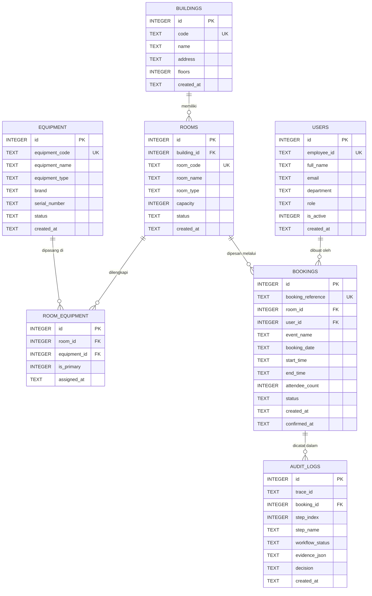
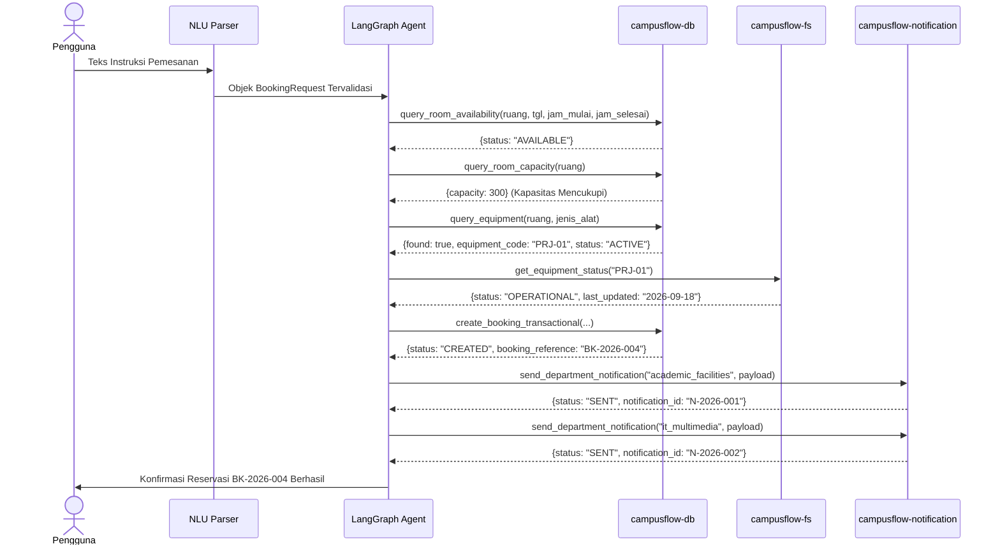

# Software Requirements Specification (SRS)
## for CampusFlow — Academic Campus Facility & Event Coordinator

---

| Bidang | Detail |
| :--- | :--- |
| **Nomor Dokumen** | CF-SRS-2026-001 |
| **Standar Acuan** | IEEE 830-1998 / ISO/IEC/IEEE 29148:2018 |
| **Versi** | 1.0 |
| **Status** | Draft |
| **Tanggal** | 26 September 2026 |
| **Penulis** | Joseph Davin |
| **Organisasi / Tim** | TalentSource — CampusFlow Core Engineering |
| **Repositori** | [github.com/TalentSource/CampusFlow](https://github.com/TalentSource/CampusFlow) |

---

## Riwayat Revisi (Revision History)

| Versi | Tanggal | Deskripsi Perubahan | Oleh |
| :---: | :---: | :--- | :--- |
| 1 | 20 Sep 2026 | Draf awal: ruang lingkup, latar belakang masalah, dan spesifikasi konteks | Joseph Davin |
| 2 | 25 Sep 2026 | Penambahan kebutuhan fungsional inti, model data 7 entitas, dan spesifikasi alat MCP | Joseph Davin |
| 3 | 26 Sep 2026 | Rekonstruksi penuh mengikuti struktur standar ISO/IEC/IEEE 29148:2018 & IEEE 830-1998 (System Features, Data Requirements, External Interfaces, Quality Attributes, Internationalization, Skenario Pengujian Acuan, Appendix A & B) | Joseph Davin |

---

## Daftar Isi (Table of Contents)

1. [Pendahuluan (Introduction)](#1-pendahuluan-introduction)
    - 1.1 [Tujuan Dokumen (Purpose)](#11-tujuan-dokumen-purpose)
    - 1.2 [Konvensi Dokumen (Document Conventions)](#12-konvensi-dokumen-document-conventions)
    - 1.3 [Ruang Lingkup Proyek (Project Scope)](#13-ruang-lingkup-proyek-project-scope)
    - 1.4 [Referensi (References)](#14-referensi-references)
2. [Deskripsi Umum (Overall Description)](#2-deskripsi-umum-overall-description)
    - 2.1 [Perspektif Produk (Product Perspective)](#21-perspektif-produk-product-perspective)
    - 2.2 [Kelas Pengguna dan Karakteristik (User Classes and Characteristics)](#22-kelas-pengguna-dan-karakteristik-user-classes-and-characteristics)
    - 2.3 [Lingkungan Operasional (Operating Environment)](#23-lingkungan-operasional-operating-environment)
    - 2.4 [Batasan Desain dan Implementasi (Design and Implementation Constraints)](#24-batasan-desain-dan-implementasi-design-and-implementation-constraints)
    - 2.5 [Asumsi dan Dependensi (Assumptions and Dependencies)](#25-asumsi-dan-dependensi-assumptions-and-dependencies)
3. [Fitur Sistem (System Features)](#3-fitur-sistem-system-features)
    - 3.1 [Fitur 1: Penerimaan & Penguraian Bahasa Alami (NLU & Entity Extraction)](#31-fitur-1-penerimaan--penguraian-bahasa-alami-nlu--entity-extraction)
    - 3.2 [Fitur 2: Validasi Ruangan & Pencegahan Bentrok Jadwal](#32-fitur-2-validasi-ruangan--pencegahan-bentrok-jadwal)
    - 3.3 [Fitur 3: Validasi Kapasitas Fasilitas](#33-fitur-3-validasi-kapasitas-fasilitas)
    - 3.4 [Fitur 4: Validasi Kebutuhan Peralatan & Pemeriksaan Log Pemeliharaan Fisik](#34-fitur-4-validasi-kebutuhan-peralatan--pemeriksaan-log-pemeliharaan-fisik)
    - 3.5 [Fitur 5: Pembuatan Reservasi Transaksional Atomik](#35-fitur-5-pembuatan-reservasi-transaksional-atomik)
    - 3.6 [Fitur 6: Orkestrasi Notifikasi Otomatis Multi-Departemen](#36-fitur-6-orkestrasi-notifikasi-otomatis-multi-departemen)
    - 3.7 [Fitur 7: Pencatatan Jejak Audit Deterministik & State Machine](#37-fitur-7-pencatatan-jejak-audit-deterministik--state-machine)
4. [Kebutuhan Data (Data Requirements)](#4-kebutuhan-data-data-requirements)
    - 4.1 [Model Data Logis (Logical Data Model)](#41-model-data-logis-logical-data-model)
    - 4.2 [Kamus Data (Data Dictionary)](#42-kamus-data-data-dictionary)
    - 4.3 [Laporan Sistem (Reports)](#43-laporan-sistem-reports)
    - 4.4 [Akuisisi, Integritas, Retensi, dan Pemusnahan Data](#44-akuisisi-integritas-retensi-dan-pemusnahan-data)
5. [Kebutuhan Antarmuka Eksternal (External Interface Requirements)](#5-kebutuhan-antarmuka-eksternal-external-interface-requirements)
    - 5.1 [Antarmuka Pengguna (User Interfaces)](#51-antarmuka-pengguna-user-interfaces)
    - 5.2 [Antarmuka Perangkat Lunak (Software Interfaces — Model Context Protocol)](#52-antarmuka-perangkat-lunak-software-interfaces--model-context-protocol)
    - 5.3 [Antarmuka Perangkat Keras (Hardware Interfaces)](#53-antarmuka-perangkat-keras-hardware-interfaces)
    - 5.4 [Antarmuka Komunikasi (Communications Interfaces)](#54-antarmuka-komunikasi-communications-interfaces)
6. [Atribut Kualitas Perangkat Lunak (Quality Attributes)](#6-atribut-kualitas-perangkat-lunak-quality-attributes)
    - 6.1 [Kebergunaan (Usability)](#61-kebergunaan-usability)
    - 6.2 [Kinerja (Performance)](#62-kinerja-performance)
    - 6.3 [Keamanan (Security)](#63-keamanan-security)
    - 6.4 [Keselamatan Sistem (Safety)](#64-keselamatan-sistem-safety)
    - 6.5 [Keandalan dan Ketersediaan (Reliability and Availability)](#65-keandalan-dan-ketersediaan-reliability-and-availability)
7. [Kebutuhan Internasionalisasi dan Lokalisasi](#7-kebutuhan-internasionalisasi-dan-lokalisasi)
    - 7.1 [Dukungan Bahasa](#71-dukungan-bahasa)
    - 7.2 [Format Tanggal, Waktu, dan Zona Lokal](#72-format-tanggal-waktu-dan-zona-lokal)
    - 7.3 [Konvensi Karakter dan Penomoran](#73-konvensi-karakter-dan-penomoran)
8. [Kebutuhan Lainnya & Verifikasi Acuan (Other Requirements)](#8-kebutuhan-lainnya--verifikasi-acuan-other-requirements)
    - 8.1 [Skenario Pengujian Acuan (Benchmark Acceptance Scenarios)](#81-skenario-pengujian-acuan-benchmark-acceptance-scenarios)
    - 8.2 [Konfigurasi Startup, Shutdown, dan Monitoring Server](#82-konfigurasi-startup-shutdown-dan-monitoring-server)
- [Lampiran A: Glosarium (Appendix A: Glossary)](#lampiran-a-glosarium-appendix-a-glossary)
- [Lampiran B: Model Analisis (Appendix B: Analysis Models)](#lampiran-b-model-analisis-appendix-b-analysis-models)

---

## 1. Pendahuluan (Introduction)

### 1.1 Tujuan Dokumen (Purpose)

Dokumen Spesifikasi Kebutuhan Perangkat Lunak (*Software Requirements Specification* — SRS) ini mendefinisikan seluruh spesifikasi kebutuhan untuk sistem **CampusFlow — Academic Campus Facility & Event Coordinator**, versi 1.0 (Draft). Dokumen ini disusun berdasarkan standar **IEEE 830-1998** dan **ISO/IEC/IEEE 29148:2018** guna menyediakan acuan teknis yang presisi, terukur, dan dapat diverifikasi secara objektif bagi perancang arsitektur, pengembang perangkat lunak, perekayasa pengujian (*QA engineers*), serta pemangku kepentingan akademik.

### 1.2 Konvensi Dokumen (Document Conventions)

Dokumen ini menggunakan konvensi penulisan dan tipografi berikut:

- **Prioritas Kebutuhan**: Setiap butir kebutuhan fungsional memiliki kode pengenal unik dengan format `REQ-[Fitur]-[Nomor]` (contoh: `REQ-NLU-01`, `REQ-BKG-01`).
- **Tingkat Keharusan**: Mengikuti standar RFC 2119 / IEEE:
  - **HARUS (SHALL / MUST)**: Menunjukkan kebutuhan mutlak yang wajib dipenuhi sistem; ketidakpatuhan dianggap kegagalan sistem.
  - **SEBAIKNYA (SHOULD)**: Menunjukkan rekomendasi kuat yang diharapkan diimplementasikan kecuali terdapat justifikasi teknis yang valid.
  - **DAPAT (MAY)**: Menunjukkan opsi fitur tambahan yang diizinkan tanpa memengaruhi kepatuhan inti.
- **Teks Kode dan Variabel**: Ditulis menggunakan font `monospaced` (contoh: `BookingRequest`, `MENUNGGU_VALIDASI`, `campusflow-db`).
- **Catatan dan Peringatan**: Diberikan penekanan visual blok kutipan (*callout block*) beraksen warna untuk menandai batasan kritis dan keputusan arsitektural.

### 1.3 Ruang Lingkup Proyek (Project Scope)

CampusFlow adalah sistem orkestrasi agen AI otonom berbasis *state-graph* yang memproses permohonan reservasi fasilitas kampus secara otomatis dari teks instruksi bahasa alami. Sistem mengonversi teks mentah menjadi entitas terstruktur, memvalidasi kelaikan melalui sembilan tahapan verifikasi deterministik pada tiga sumber data independen melalui *Model Context Protocol* (MCP), mengeksekusi reservasi atomik dalam basis data, dan menerbitkan notifikasi otomatis antar-departemen.

#### 1.3.1 Sembilan Tahapan Validasi Berurutan
Sistem menjamin keabsahan reservasi melalui 9 tahapan berurutan (*fail-fast pipeline*):

1. **Penerimaan Permintaan (*Request Ingestion*)**: Menangkap dan mencatat teks mentah dari pengguna beserta stempel waktu.
2. **Penguraian Entitas (*Entity Extraction*)**: Mengekstrak parameter pemesanan (ruangan, tanggal, jam mulai/selesai, jumlah peserta, peralatan pendukung).
3. **Validasi Kelengkapan (*Requirements Validation*)**: Memverifikasi pemenuhan seluruh parameter wajib sebelum memicu kueri basis data.
4. **Pencarian Ruangan (*Room Resolution*)**: Mencari ruangan yang sesuai di katalog basis data operasional.
5. **Pengecekan Ketersediaan (*Room Availability Verification*)**: Memeriksa bentrok jadwal terhadap seluruh reservasi aktif pada jendela waktu yang diminta.
6. **Validasi Kapasitas (*Capacity Validation*)**: Membandingkan jumlah peserta terhadap batas kapasitas aman ruangan.
7. **Pengecekan Peralatan (*Equipment Presence Verification*)**: Memeriksa kelengkapan peralatan yang terpasang di ruangan atau ketersediaan unit portabel.
8. **Verifikasi Fisik Peralatan (*Physical Equipment Health Check*)**: Membaca catatan servis fisik independen guna mendeteksi kerusakan yang belum tercermin di basis data utama.
9. **Otorisasi & Komit Transaksional (*Booking Authorization & Notification*)**: Menulis reservasi secara atomik dan mengirim notifikasi otomatis ke departemen terkait.

#### 1.3.2 Batasan Ruang Lingkup Sistem

- **Cakupan Sistem (In-Scope)**:
  - Penerimaan teks instruksi dalam Bahasa Indonesia dan Bahasa Inggris.
  - Penguraian deterministik/LLM dengan mekanisme konfirmasi ambiguitas waktu.
  - Verifikasi silang antara basis data SQLite dan log pemeliharaan fisik berbasis berkas teks.
  - Transaksi reservasi atomik berstatus `CONFIRMED`.
  - Pemicuan notifikasi otomatis multi-departemen (Fasilitas, TI Multimedia, Keamanan).
  - Pencatatan seluruh keputusan pada log audit terstruktur.
- **Di Luar Cakupan (Out-of-Scope)**:
  - Sistem pembayaran atau integrasi *payment gateway*.
  - Autentikasi biometrik atau integrasi protokol SSO eksternal institusi.
  - Pengendalian perangkat keras Internet of Things (IoT) secara langsung.
  - Penjadwalan mata kuliah reguler semesteran universitas.
  - Pembatalan atau perubahan (*rescheduling*) reservasi yang telah berstatus `CONFIRMED`.
  - Pemesanan multi-ruangan sekaligus dalam satu klausa instruksi.
  - Dashboard analitik grafis visual berbasis web (GUI pelaporan).

### 1.4 Referensi (References)

1. IEEE Std 830-1998, *IEEE Recommended Practice for Software Requirements Specifications*.
2. ISO/IEC/IEEE 29148:2018, *Systems and software engineering — Life cycle processes — Requirements engineering*.
3. Model Context Protocol (MCP) Specification, Version 2024-11-05, Anthropic PBC.
4. RFC 2119, *Key words for use in RFCs to Indicate Requirement Levels*, Harvard University, 1997.
5. SQLite Database Engine Specification & Write-Ahead Logging (WAL) Architecture, Hwaci, Inc.
6. CampusFlow Architecture Decisions & System Context, Dokumen Internal Proyek CF-ADR-001–004.

---

## 2. Deskripsi Umum (Overall Description)

### 2.1 Perspektif Produk (Product Perspective)

CampusFlow hadir sebagai sistem orkestrator otonom generasi baru (*Agentic Facility Coordinator*) yang menggantikan proses birokrasi manual kampus. Di banyak institusi akademik, permohonan fasilitas melibatkan formulir kertas atau *spreadsheet* manual yang rentan terhadap tiga kegagalan sistemik:

1. **Bentrok Jadwal Tersembunyi**: Pemesanan ganda akibat ketiadaan isolasi transaksi atomik pada sistem pemesanan.
2. **Kebutaan Kondisi Fisik Alat**: Peralatan di basis data berstatus `ACTIVE`, namun pada kenyataannya sedang rusak di lapangan menurut catatan servis teknisi.
3. **Kelalaian Koordinasi Antar-Unit**: Staf fasilitas lupa menghubungi tim TI Multimedia atau Keamanan sebelum acara dimulai.

CampusFlow beroperasi sebagai simpul orkestrator sentral yang menghubungkan antarmuka pengguna (CLI atau Web Chat UI) dengan tiga sistem subsistem data terisolasi melalui perantara standar *Model Context Protocol* (MCP):

- Subsistem Basis Data Operasional: `campusflow-db` (berbasis SQLite WAL).
- Subsistem Sistem Berkas Log Pemeliharaan: `campusflow-fs` (membaca berkas teks catatan fisik).
- Subsistem Distribusi Notifikasi: `campusflow-notification` (penyimpanan dan pengiriman pesan JSON).

### 2.2 Kelas Pengguna dan Karakteristik (User Classes and Characteristics)

| Kelas Pengguna | Peran Sistem | Karakteristik Teknis | Kebutuhan Utama |
| :--- | :--- | :--- | :--- |
| **Dosen / Penyelenggara Acara** | Pemohon Langsung (*Requester*) | Pengguna non-teknis, berinteraksi melalui instruksi bahasa alami santai atau semi-formal | Memesan ruangan yang sesuai, kapasitas memadai, dan fasilitas bekerja tanpa harus mengisi puluhan kolom form |
| **Staf Administrasi Fakultas** | Pemohon Kuasa (*Requester on-behalf*) | Terbiasa dengan entri data cepat, membutuhkan kepastian jadwal instan | Memproses pemesanan delegasi pimpinan dan memastikan tidak ada bentrok ruang |
| **Teknisi TI & Audio-Visual** | Pemangku Kepentingan Operasional | Terfokus pada log servis berkas teks lokal dan inventaris fisik alat | Menerima notifikasi otomatis kebutuhan proyektor/audio dan menjaga agar alat rusak tidak dijadwalkan |
| **Petugas Fasilitas & Keamanan** | Pemangku Kepentingan Keamanan | Memerlukan manifes operasional ruangan di luar jam operasional standar | Menerima daftar acara terkonfirmasi untuk pembukaan kunci pintu dan pengawasan gedung |
| **Auditor / Administrator Sistem** | Pengawas Kepatuhan (*Auditor*) | Pengguna tingkat lanjut (*technical advanced*) | Menelaah jejak log audit deterministik untuk setiap penolakan atau persetujuan reservasi |

### 2.3 Lingkungan Operasional (Operating Environment)

Sistem CampusFlow dirancang untuk beroperasi pada lingkungan teknis berikut:

- **Sistem Operasi**: Lintas platform (Windows 10/11 64-bit, Ubuntu Linux 22.04 LTS+, macOS Sonoma+).
- **Runtime Utama**: Python 3.12+ (64-bit).
- **Arsitektur Eksekusi**: Proses Python terisolasi yang berkomunikasi via pipa saluran standar (*standard input/output — stdio*) menggunakan protokol MCP.
- **Penyimpanan Lokal**: SQLite 3.45+ dengan konfigurasi `PRAGMA journal_mode=WAL;` dan berkas log audit terindeks.
- **Konektivitas LLM (Opsional)**: Akses keluar melalui port HTTPS 443 ke penyedia API LLM (mis. Google Gemini, Claude, atau OpenAI). Jika koneksi tidak tersedia, sistem beralih otomatis ke *Deterministic Regex Engine*.

### 2.4 Batasan Desain dan Implementasi (Design and Implementation Constraints)

1. **Batasan Komunikasi Alat (MCP Standard)**: Agen LangGraph tidak diizinkan mengakses berkas basis data SQLite atau direktori file log secara langsung melalui modul `sqlite3` atau `os`. Seluruh akses data wajib melewati klien MCP berstandar JSON-RPC 2.0 via `stdio`.
2. **Kemandirian Keputusan (Safety Invariant)**: LLM hanya diizinkan mengurai bahasa alami. Seluruh validasi bentrok tanggal, kapasitas, ketersediaan alat, dan komit transaksi dikendalikan oleh fungsi logika deterministik murni (*rule-based routers*).
3. **Isolasi Mutlak Notifikasi**: Server `campusflow-notification` beroperasi terisolasi dari database `campusflow-db`. Kegagalan pengiriman notifikasi tidak boleh membatalkan (*rollback*) transaksi reservasi yang telah sah.
4. **Dependensi Standar Terbuka**: Sistem dibangun menggunakan pustaka standar terbuka tanpa keterikatan pada infrastruktur komputasi awan berbayar (*no cloud-vendor lock-in*).

### 2.5 Asumsi dan Dependensi (Assumptions and Dependencies)

- **Asumsi Integritas Log Servis**: Berkas log pemeliharaan fisik di `data/filesystem/maintenance/` diperbarui secara berkala oleh staf teknisi lapangan.
- **Asumsi Keandalan Jam Sistem**: Jam perangkat keras (*system clock*) server akurat dan disinkronisasi via Network Time Protocol (NTP) untuk validasi waktu saat ini.
- **Dependensi Kerangka Kerja**: Bergantung pada modul Python `pydantic` versi 2.x untuk validasi skema data dan `langgraph` versi 0.2+ untuk orkestrasi graf status alur kerja.

---

## 3. Fitur Sistem (System Features)

### 3.1 Fitur 1: Penerimaan & Penguraian Bahasa Alami (NLU & Entity Extraction)

#### 3.1.1 Deskripsi Fitur
Sistem menerima input instruksi bebas dalam Bahasa Indonesia atau Bahasa Inggris dari antarmuka pengguna, mengekstrak entitas-entitas pemesanan esensial, memvalidasi struktur data, dan menanganani ambiguitas tanggal relatif.

#### 3.1.2 Sekuens Stimulus / Respons

1. Pengguna memasukkan teks instruksi: *"Pesan auditorium utama untuk workshop AI 100 orang pada Selasa depan jam 09:00 sampai 11:00, pastikan proyektor berfungsi."*
2. Sistem mengeksekusi parser NLU (berbasis LLM dengan fallback ke Deterministic Pattern Matcher).
3. Apabila tanggal bernilai relatif (mis. *"Selasa depan"*), sistem menghitung tanggal kalender absolut dan mengajukan konfirmasi eksplisit kepada pengguna sebelum alur kerja diteruskan.
4. Sistem memvalidasi kelengkapan data. Jika lengkap, status alur kerja diubah menjadi `REQUIREMENTS_VALIDATED`. Jika tidak lengkap atau format salah, status diubah menjadi `INVALID_REQUEST` disertai alasan penolakan.

#### 3.1.3 Kebutuhan Fungsional Terinci

- **REQ-NLU-01**: Sistem HARUS mengekstrak minimal 5 parameter utama dari teks masukan: `room_name` (nama ruangan), `booking_date` (tanggal pemesanan format YYYY-MM-DD), `start_time` (jam mulai format HH:MM), `end_time` (jam selesai format HH:MM), dan `attendee_count` (jumlah peserta).
- **REQ-NLU-02**: Sistem HARUS mengekstrak daftar `required_equipment` jika disebutkan dalam instruksi pengguna.
- **REQ-NLU-03**: Sistem HARUS memvalidasi bahwa `start_time` lebih awal daripada `end_time`.
- **REQ-NLU-04**: Jika tanggal diberikan dalam bentuk relatif ambigu, sistem HARUS menghitung tanggal absolut terdekat dan meminta konfirmasi pengguna sebelum melanjutkan ke tahap kueri data.
- **REQ-NLU-05**: Sistem HARUS menyediakan mesin fallback deterministik berbasis regex apabila layanan API LLM mengalami kendala latensi atau ketiadaan kunci API.

### 3.2 Fitur 2: Validasi Ruangan & Pencegahan Bentrok Jadwal

#### 3.2.1 Deskripsi Fitur
Sistem memverifikasi keberadaan ruangan dalam inventaris kampus dan memastikan tidak ada irisan jadwal dengan reservasi lain yang telah berstatus `CONFIRMED`.

#### 3.2.2 Sekuens Stimulus / Respons

1. Agen mengirim permintaan `query_room_availability` ke server `campusflow-db`.
2. Server MCP mengeksekusi kueri pengecekan bentrok jadwal terhadap tabel `bookings`.
3. Jika ditemukan reservasi bertumpuk, sistem menetapkan status alur kerja `CONFLICT_DETECTED` dan memutus alur kerja (*fail-fast*).
4. Jika tidak ada bentrok, status dialihkan ke pemeriksaan kapasitas.

#### 3.2.3 Kebutuhan Fungsional Terinci

- **REQ-BKG-01**: Sistem HARUS menganggap dua rentang waktu $[S_1, E_1)$ dan $[S_2, E_2)$ berbenturan jika dan hanya jika $S_1 < E_2 \land E_1 > S_2$.
- **REQ-BKG-02**: Batas waktu yang bersinggungan persis (contoh: Acara A selesai pukul 11:00 dan Acara B mulai pukul 11:00) HARUS dinyatakan TIDAK berbenturan (*valid contiguous booking*).
- **REQ-BKG-03**: Jika ruangan yang diminta tidak ditemukan di database, sistem HARUS menghentikan alur kerja dengan status `ROOM_NOT_FOUND`.
- **REQ-BKG-04**: Jika ruangan sedang dalam renovasi (`UNDER_RENOVATION`), sistem HARUS menolak pemesanan dengan status `ROOM_UNAVAILABLE`.

### 3.3 Fitur 3: Validasi Kapasitas Fasilitas

#### 3.3.1 Deskripsi Fitur
Sistem membandingkan estimasi peserta acara terhadap kapasitas resmi ruangan guna memastikan kenyamanan dan kepatuhan standar keselamatan gedung.

#### 3.3.2 Sekuens Stimulus / Respons

1. Agen memanggil alat `query_room_capacity` ke server `campusflow-db`.
2. Basis data mengembalikan angka kapasitas maksimal ruangan.
3. Agen mengevaluasi kondisi: `attendee_count <= capacity`.
4. Jika peserta melebihi kapasitas, sistem menetapkan status `CAPACITY_EXCEEDED` dan menghentikan proses pemesanan.

#### 3.3.3 Kebutuhan Fungsional Terinci

- **REQ-CAP-01**: Sistem HARUS menolak pemesanan apabila `attendee_count` lebih besar daripada `rooms.capacity`.
- **REQ-CAP-02**: Pesan penolakan kapasitas HARUS memuat informasi kapasitas riil ruangan dan jumlah peserta yang diajukan agar pengguna memahami alasan kegagalan.

### 3.4 Fitur 4: Validasi Kebutuhan Peralatan & Pemeriksaan Log Pemeliharaan Fisik

#### 3.4.1 Deskripsi Fitur
Sistem melakukan verifikasi silang dua lapis: memastikan peralatan terdaftar di ruangan pada basis data operasional, kemudian memeriksa berkas log servis fisik independen di sistem berkas untuk memastikan alat tidak dalam keadaan rusak.

#### 3.4.2 Sekuens Stimulus / Respons

1. Agen memanggil `query_equipment` ke server `campusflow-db` untuk memverifikasi ketersediaan tipe alat di ruangan.
2. Jika terdaftar `ACTIVE`, agen mengambil kode identifikasi unik unit (contoh: `PRJ-02`).
3. Agen memanggil `search_maintenance_log` ke server `campusflow-fs` untuk memeriksa catatan servis berkas teks unit tersebut.
4. Jika catatan log fisik berstatus `UNDER_MAINTENANCE` atau `FAULTY`, agen mengabaikan status `ACTIVE` di basis data utama dan membatalkan alur kerja dengan status `EQUIPMENT_FAULTY`.

#### 3.4.3 Kebutuhan Fungsional Terinci

- **REQ-EQP-01**: Jika peralatan yang diminta tidak tersedia di ruangan atau inventaris kampus, sistem HARUS menghentikan alur kerja dengan status `EQUIPMENT_UNAVAILABLE`.
- **REQ-EQP-02**: Sistem HARUS memprioritaskan bukti fisik dari `campusflow-fs` di atas status basis data `campusflow-db` apabila terjadi inkonsistensi (*physical evidence supremacy*).
- **REQ-EQP-03**: Sistem HARUS mencatat nomor referensi log pemeliharaan ke dalam bukti keputusan audit (*audit evidence*).

### 3.5 Fitur 5: Pembuatan Reservasi Transaksional Atomik

#### 3.5.1 Deskripsi Fitur
Sistem mengeksekusi penulisan catatan reservasi ke dalam basis data utama melalui satu transaksi atomik yang terisolasi dengan nomor referensi unik.

#### 3.5.2 Sekuens Stimulus / Respons

1. Setelah seluruh 8 tahapan validasi sebelumnya berhasil, agen memanggil `create_booking_transactional` pada `campusflow-db`.
2. Basis data membuka transaksi (`BEGIN IMMEDIATE`), memeriksa ulang ketiadaan bentrok, menghasilkan nomor referensi berformat `BK-YYYY-NNN`, memasukkan baris baru, dan melakukan komit (`COMMIT`).
3. Status alur kerja bergeser ke `BOOKING_CONFIRMED`.

#### 3.5.3 Kebutuhan Fungsional Terinci

- **REQ-TXN-01**: Penulisan reservasi HARUS bersifat atomik (semua tersimpan atau tidak sama sekali).
- **REQ-TXN-02**: Nomor referensi reservasi HARUS berformat `BK-YYYY-NNN` (contoh: `BK-2026-004`) dan bernilai unik (*UNIQUE constraint*).
- **REQ-TXN-03**: Status baris reservasi yang baru dibuat HARUS langsung bernilai `CONFIRMED`.

### 3.6 Fitur 6: Orkestrasi Notifikasi Otomatis Multi-Departemen

#### 3.6.1 Deskripsi Fitur
Sistem menentukan target departemen yang relevan secara otomatis berdasarkan karakteristik pemesanan (tipe ruangan dan peralatan) dan menerbitkan notifikasi tanpa membutuhkan instruksi manual dari pengguna.

#### 3.6.2 Sekuens Stimulus / Respons

1. Simpul otorisasi mengevaluasi atribut pemesanan yang telah dikonfirmasi.
2. Aturan penentuan target dijalankan:
    - Ruangan manapun $\rightarrow$ Bagian Fasilitas Kampus (`academic_facilities`).
    - Melibatkan proyektor / mikrofon / sound system $\rightarrow$ Tim TI & Multimedia (`it_multimedia`).
    - Acara di luar jam kerja (setelah 18:00 atau akhir pekan) $\rightarrow$ Unit Keamanan Kampus (`campus_security`).
3. Agen memanggil `send_department_notification` ke server `campusflow-notification` untuk setiap target departemen.
4. Notifikasi disimpan sebagai dokumen JSON terstruktur.

#### 3.6.3 Kebutuhan Fungsional Terinci

- **REQ-NTF-01**: Sistem HARUS mengirim notifikasi ke unit terkait secara otomatis berdasarkan aturan konteks tanpa memerlukan frasa perintah "beri tahu tim" dari pengguna.
- **REQ-NTF-02**: Setiap notifikasi HARUS memuat referensi ID pemesanan, nama ruangan, tanggal, waktu, dan rincian peralatan pendukung.
- **REQ-NTF-03**: Notifikasi HARUS disimpan dalam format file JSON terpisah dengan pengenal berformat `N-YYYY-NNN`.

### 3.7 Fitur 7: Pencatatan Jejak Audit Deterministik & State Machine

#### 3.7.1 Deskripsi Fitur
Sistem mencatat setiap langkah penalaran, data bukti yang diverifikasi, dan keputusan simpul graf alur kerja ke dalam tabel audit yang tidak dapat diubah (*append-only*).

#### 3.7.2 Sekuens Stimulus / Respons

1. Setiap kali simpul LangGraph selesai mengeksekusi logika, fungsi router mencatat masukan, keluaran, dan status transisi ke `audit_logs`.
2. Jika terjadi kegagalan di langkah manapun, simpul transisi mengalihkan alur ke `handle_failure`, mencatat alasan spesifik, dan menutup eksekusi dengan rapi.

#### 3.7.3 Kebutuhan Fungsional Terinci

- **REQ-AUD-01**: Sistem HARUS mencatat setiap transisi langkah ke tabel `audit_logs` dengan kolom: `trace_id`, `step_index`, `step_name`, `workflow_status`, `evidence_json`, dan `decision`.
- **REQ-AUD-02**: Log audit bersifat *append-only*; operasi pembaruan (`UPDATE`) atau penghapusan (`DELETE`) pada tabel audit dilarang keras.
- **REQ-AUD-03**: Seluruh perpindahan status alur kerja HARUS dikendalikan oleh fungsi penentu deterministik (*deterministic state-machine router*).

---

## 4. Kebutuhan Data (Data Requirements)

### 4.1 Model Data Logis (Logical Data Model)

Sistem mengelola relasi data antara bangunan, ruangan, inventaris peralatan, reservasi, dan jejak audit melalui model entitas-relasional (*Entity-Relationship Diagram*) berikut:



### 4.2 Kamus Data (Data Dictionary)

#### 4.2.1 Tabel Entitas Utama

| Entitas | Kolom | Tipe Data | Batasan Kunci | Deskripsi |
| :--- | :--- | :--- | :--- | :--- |
| **BUILDINGS** | `id` | INTEGER | PRIMARY KEY | Identifikator unik bangunan |
| | `code` | TEXT | UNIQUE, NOT NULL | Kode gedung (contoh: `MAIN`, `SCI`, `ENG`) |
| | `name` | TEXT | NOT NULL | Nama resmi gedung fasilitas |
| **ROOMS** | `id` | INTEGER | PRIMARY KEY | Identifikator unik ruangan |
| | `building_id` | INTEGER | FOREIGN KEY | Relasi ke `BUILDINGS.id` |
| | `room_code` | TEXT | UNIQUE, NOT NULL | Kode ruangan (contoh: `AUD-01`, `SR-101`) |
| | `room_name` | TEXT | NOT NULL | Nama deskriptif ruangan |
| | `room_type` | TEXT | NOT NULL | Klasifikasi jenis ruangan |
| | `capacity` | INTEGER | NOT NULL | Batas daya tampung maksimal |
| | `status` | TEXT | NOT NULL | Status ketersediaan fisik ruangan |
| **EQUIPMENT** | `id` | INTEGER | PRIMARY KEY | Identifikator unik peralatan |
| | `equipment_code` | TEXT | UNIQUE, NOT NULL | Kode seri inventaris (contoh: `PRJ-01`, `MIC-01`) |
| | `equipment_name` | TEXT | NOT NULL | Nama deskriptif alat |
| | `equipment_type` | TEXT | NOT NULL | Kategori peralatan |
| | `status` | TEXT | NOT NULL | Status pencatatan di database |
| **BOOKINGS** | `id` | INTEGER | PRIMARY KEY | Identifikator unik reservasi |
| | `booking_reference` | TEXT | UNIQUE, NOT NULL | Kode referensi pemesanan (`BK-YYYY-NNN`) |
| | `room_id` | INTEGER | FOREIGN KEY | Relasi ke `ROOMS.id` |
| | `booking_date` | TEXT | NOT NULL | Tanggal pemesanan (`YYYY-MM-DD`) |
| | `start_time` | TEXT | NOT NULL | Waktu mulai (`HH:MM`) |
| | `end_time` | TEXT | NOT NULL | Waktu selesai (`HH:MM`) |
| | `attendee_count` | INTEGER | NOT NULL | Jumlah peserta yang diajukan |
| | `status` | TEXT | NOT NULL | Status reservasi saat ini |
| **AUDIT_LOGS** | `id` | INTEGER | PRIMARY KEY | Identifikator unik baris log |
| | `trace_id` | TEXT | NOT NULL | UUID pelacakan unik satu sesi permohonan |
| | `step_name` | TEXT | NOT NULL | Nama simpul graf LangGraph |
| | `workflow_status` | TEXT | NOT NULL | Status alur kerja pada langkah bersangkutan |
| | `evidence_json` | TEXT | NULLABLE | Cuplikan data bukti dalam JSON |
| | `decision` | TEXT | NOT NULL | Keputusan yang diambil (`PASS`, `FAIL`, dll.) |

#### 4.2.2 Nilai Enumerasi Standar

- `rooms.status`: `ACTIVE`, `INACTIVE`, `UNDER_RENOVATION`
- `rooms.room_type`: `auditorium`, `seminar_room`, `lecture_hall`, `conference_room`, `computer_lab`, `laboratory`
- `equipment.status`: `ACTIVE`, `INACTIVE`, `UNDER_MAINTENANCE`, `DECOMMISSIONED`
- `equipment.equipment_type`: `projector`, `microphone`, `sound_system`, `whiteboard`, `smartboard`, `computer`, `video_conferencing`, `air_conditioning`, `lighting`
- `bookings.status`: `CONFIRMED`, `CANCELLED`, `COMPLETED`
- `users.role`: `faculty`, `staff`, `student`, `admin`

### 4.3 Laporan Sistem (Reports)

Sistem menghasilkan tiga format artefak keluaran terstruktur:

1. **Bukti Konfirmasi Pemesanan (*Booking Confirmation Slip*)**: Diterbitkan saat reservasi sukses; memuat Nomor Referensi, Nama Pemohon, Detail Ruangan, Waktu Acara, Peralatan Terpasang, serta ID Notifikasi yang diterbitkan.
2. **Laporan Audit Alur Pemesanan (*Workflow Execution Trace Report*)**: Berkas JSON yang memuat seluruh riwayat pembuktian simpul dari `trace_id` terkait.
3. **Pemberitahuan Disposisi Departemen (*Department Notification Payload*)**: Dokumen JSON yang ditempatkan pada sistem berkas departemen tujuan.

### 4.4 Akuisisi, Integritas, Retensi, dan Pemusnahan Data

- **Pemberlakuan Integritas SQLite WAL**: Basis data beroperasi dalam mode `PRAGMA journal_mode=WAL;` dan `PRAGMA foreign_keys=ON;` guna menjamin keandalan data dari kondisi pemadaman listrik mendadak (*crash resilience*).
- **Kebijakan Transaksi Atomik**: Penulisan ke tabel `bookings` dan penambahan baris `audit_logs` awal dieksekusi dalam blok transaksi `BEGIN IMMEDIATE ... COMMIT`.
- **Retensi Log**: Seluruh catatan pemesanan dan log audit dipertahankan minimal selama 5 (lima) tahun akademik berjalan untuk kebutuhan akreditasi institusi.
- **Pemusnahan Data**: Berkas sementara (*temporary scratch logs*) yang tidak terikat pada `trace_id` terdaftar dibersihkan secara otomatis setiap 30 hari.

---

## 5. Kebutuhan Antarmuka Eksternal (External Interface Requirements)

### 5.1 Antarmuka Pengguna (User Interfaces)

Sistem menyediakan dua pilihan antarmuka bagi pengguna:

#### 5.1.1 Antarmuka Baris Perintah Interaktif (CLI)

- Mode interaktif (`campusflow --interactive`) menerima input teks baris perintah dan menampilkan progres eksekusi sembilan langkah validasi secara langsung.
- Mode satu-baris (`campusflow --request "..."`) untuk pengujian otomatis dan skrip *pipeline*.
- Menampilkan pesan konfirmasi status berwarna: Hijau (`CONFIRMED`), Merah (`REJECTED`), dan Kuning (`NEEDS_CLARIFICATION`).

#### 5.1.2 Antarmuka Agen Percakapan Web (Web Chat Agent UI)

- Komponen antarmuka berbasis web responsif bergaya agen percakapan modern (mirip antarmuka Gemini / ChatGPT).
- Menampilkan gelembung percakapan (*chat bubbles*), kartu ringkasan fasilitas (*facility preview card*), dan tombol konfirmasi interaktif untuk tanggal relatif ambigu.
- Terhubung ke subsistem agen melalui endpoint WebSocket atau REST API lokal.

### 5.2 Antarmuka Perangkat Lunak (Software Interfaces — Model Context Protocol)

Komunikasi antara agen LangGraph dan subsistem data dieksekusi melalui standar **Model Context Protocol (MCP)** dengan 3 server lokal:

```
┌─────────────────────────────────────────────────────────────┐
│                    LANGGRAPH AGENT                          │
│        (Orkestrasi Alur Kerja & Mesin Status)               │
└──────────────┬──────────────┬──────────────┬────────────────┘
               │              │              │
        stdio (JSON-RPC) stdio (JSON-RPC) stdio (JSON-RPC)
               │              │              │
┌──────────────▼───┐   ┌──────▼────────┐   ┌─▼────────────────┐
│  campusflow-db   │   │ campusflow-fs │   │  campusflow-     │
│   (Basis Data)   │   │(Sistem Berkas)│   │  notification    │
│                  │   │               │   │   (Notifikasi)   │
└──────────────────┘   └───────────────┘   └──────────────────┘
```

#### 5.2.1 Katalog Alat MCP `campusflow-db`

1. `query_room_availability(room_name, booking_date, start_time, end_time)`: Memeriksa ketersediaan ruangan pada tanggal dan rentang waktu yang diminta.
2. `query_room_capacity(room_name)`: Mengambil angka kapasitas ruangan dan status fisiknya.
3. `query_equipment(room_name, equipment_type)`: Mengambil daftar peralatan yang tersedia di ruangan.
4. `create_booking_transactional(room_name, user_id, event_name, booking_date, start_time, end_time, attendee_count)`: Menuliskan reservasi ke basis data dalam transaksi aman.
5. `inspect_schema()`: Mengembalikan skema lengkap basis data untuk keperluan inspeksi.

#### 5.2.2 Katalog Alat MCP `campusflow-fs`

1. `read_file(path)`: Membaca berkas log teks di direktori sistem berkas.
2. `search_maintenance_log(equipment_code)`: Mencari catatan servis pemeliharaan fisik alat tertentu.
3. `get_equipment_status(equipment_code)`: Mengembalikan status kelaikan fisik riil alat dari sistem berkas teknisi.

#### 5.2.3 Katalog Alat MCP `campusflow-notification`

1. `send_department_notification(department, booking_id, message, priority)`: Menulis berkas notifikasi untuk departemen terkait.
2. `get_notification_status(notification_id)`: Memeriksa status pengiriman notifikasi.
3. `list_department_notifications(department)`: Menampilkan seluruh notifikasi milik departemen terkait.

### 5.3 Antarmuka Perangkat Keras (Hardware Interfaces)

- Sistem CampusFlow adalah perangkat lunak tingkat aplikasi murni (*application-level software*).
- **Batasan Perangkat Keras**: Sistem TIDAK memiliki antarmuka langsung ke perangkat keras IoT (seperti saklar relai proyektor, sensor gerak PIR ruangan, pengontrol sistem tata suara, atau kunci pintu RFID). Seluruh otorisasi fisik didelegasikan kepada staf yang menerima notifikasi resmi sistem.

### 5.4 Antarmuka Komunikasi (Communications Interfaces)

- **Komunikasi Internal**: Seluruh komunikasi antara Agen Orkestrator dan Server MCP menggunakan pertukaran pesan berformat **JSON-RPC 2.0** melalui saluran *Standard Input / Standard Output* (`stdio`).
- **Protokol Jaringan Luar**: Jika Web Chat UI diaktifkan, antarmuka berkomunikasi melalui protokol HTTP/1.1 atau WebSocket terenkripsi pada `localhost`. Panggilan ke API LLM menggunakan protokol TLS 1.3 melalui port HTTPS 443.

---

## 6. Atribut Kualitas Perangkat Lunak (Quality Attributes)

### 6.1 Kebergunaan (Usability)

- **Ketahanan Frasa Masukan**: Sistem mampu mengurai struktur kalimat majemuk, istilah singkatan kampus (mis. *"Auditorium"*, *"Lab Komp"*, *"Gedung Utama"*), serta format waktu 12-jam (*am/pm*) maupun 24-jam.
- **Klarifikasi Ambiguitas**: Sistem tidak membuat asumsi buta saat mendeteksi tanggal ambigu seperti *"Selasa depan"*, melainkan mengajukan opsi tanggal eksplisit untuk persetujuan pengguna.
- **Umpan Balik Informatif**: Setiap penolakan permohonan disertai alasan kausal yang transparan (misal: menyebutkan nama acara yang bertabrakan waktu atau kode alat yang sedang dalam status perbaikan fisik).

### 6.2 Kinerja (Performance)

- **Waktu Tanggap Eksekusi**: Waktu total pemrosesan permohonan dari penerimaan teks hingga hasil akhir (termasuk 9 tahapan validasi) HARUS diselesaikan dalam waktu kurang dari 3.0 detik pada mode *deterministic fallback*, dan kurang dari 6.0 detik apabila memanfaatkan layanan API LLM daring.
- **Isolasi Non-Blokir**: Pengecekan baca status log fisik di `campusflow-fs` tidak boleh mengunci (*lock*) basis data transaksi `campusflow-db`.
- **Efisiensi Kueri**: Pemeriksaan bentrok jadwal pada tabel `bookings` memanfaatkan indeks gabungan `(room_id, booking_date, status)` guna menjaga latensi kueri di bawah 15 milidetik.

### 6.3 Keamanan (Security)

- **Prinsip Hak Akses Terkecil (*Principle of Least Privilege*)**: Klien MCP beroperasi dengan wewenang terisolasi. Server `campusflow-fs` hanya memiliki izin baca (*read-only*) pada direktori `data/filesystem/maintenance/` dan tidak memiliki akses ke direktori sistem operasi lainnya.
- **Pencegahan Injeksi SQL**: Seluruh kueri basis data pada server `campusflow-db` wajib menggunakan *parameterized queries* (`?` placeholders). Penggabungan string mentah (*string concatenation*) pada kueri SQL dilarang keras.
- **Sanitasi Jalur Berkas (*Path Traversal Defense*)**: Server `campusflow-fs` wajib menolak jalur berkas yang memuat indikasi manipulasi relatif (contoh: `../` atau `..\\`).

### 6.4 Keselamatan Sistem (Safety)

- **Invarian Anti Pemesanan Ganda (*Double-Booking Invariant*)**: Sistem tidak boleh mengeluarkan dua status `CONFIRMED` untuk satu ruangan pada jendela waktu yang bertumpang-tindih dalam kondisi beban kerja berapapun.
- **Kegagalan Aman (*Fail-Safe Defaults*)**: Jika salah satu simpul validasi mengalami kegagalan teknis (*unhandled exception*), status alur kerja otomatis beralih ke `WORKFLOW_ABORTED` dan basis data membatalkan transaksi (*rollback*).

### 6.5 Keandalan dan Ketersediaan (Reliability and Availability)

- **Determinisme Status**: Diberikan kumpulan input dan status data yang identik, mesin orkestrator akan selalu menghasilkan status akhir dan jejak audit yang identik (*reproducible state*).
- **Idempotensi Pengiriman**: Pengiriman ulang notifikasi untuk ID pemesanan yang sama tidak akan menghasilkan entri ganda pada target departemen.

---

## 7. Kebutuhan Internasionalisasi dan Lokalisasi

### 7.1 Dukungan Bahasa

- Sistem HARUS mendukung instruksi masukan bahasa alami dalam **Bahasa Indonesia** dan **Bahasa Inggris**.
- Pesan kesalahan standar dan laporan konfirmasi diterbitkan dalam Bahasa Indonesia formal yang baku dan profesional.

### 7.2 Format Tanggal, Waktu, dan Zona Lokal

- **Zona Waktu Acuan**: Seluruh kalkulasi waktu dan penanggalan merujuk pada Waktu Indonesia Barat (**WIB / UTC+7**).
- **Format Tanggal Eksternal**: Tampilan kepada pengguna menggunakan konvensi penanggalan Indonesia (contoh: `26 September 2026`).
- **Format Tanggal Internal**: Penyimpanan di database dan berkas JSON wajib mengikuti standar ISO 8601 (`YYYY-MM-DD` dan waktu `HH:MM`).
- **Penerjemahan Hari Relatif**: Pengenalan hari dalam bahasa Indonesia (*Senin*, *Selasa*, *Rabu*, *Kamis*, *Jumat*, *Sabtu*, *Minggu*) dan istilah waktu lokal (*pagi*, *siang*, *sore*, *malam*).

### 7.3 Konvensi Karakter dan Penomoran

- Sistem menggunakan penyandian karakter **UTF-8** standar tanpa BOM pada seluruh masukan teks, antarmuka JSON-RPC, berkas log, dan basis data SQLite.
- Karakter tanda hubung formal (*en-dash* dan *em-dash*) didukung penuh tanpa kerusakan representasi glif (*encoding artifacts*).

---

## 8. Kebutuhan Lainnya & Verifikasi Acuan (Other Requirements)

### 8.1 Skenario Pengujian Acuan (Benchmark Acceptance Scenarios)

Implementasi sistem dinyatakan memenuhi kepatuhan SRS ini apabila lulus seluruh 10 skenario pengujian acuan berikut yang dijalankan melalui suite pengujian otomatis `pytest`:

| No. Uji | Skenario | Kondisi Lingkungan | Masukan Pengguna | Hasil Akhir yang Diharapkan |
| :---: | :--- | :--- | :--- | :--- |
| **TC-01** | Jalur Sukses Penuh | Auditorium Utama kosong, kapasitas cukup, proyektor berfungsi | *"Pesan auditorium utama untuk workshop AI 100 orang pada 23 September 2026 jam 09:00 sampai 11:00, pastikan proyektor berfungsi."* | `CONFIRMED`, referensi `BK-YYYY-NNN`, notifikasi terkirim ke `academic_facilities` dan `it_multimedia`. |
| **TC-02** | Bentrok Jadwal | Ruang Seminar 101 telah terisi pada 09:00–11:00 | *"Pesan Ruang Seminar 101 untuk diskusi 15 orang pada 24 September 2026 jam 10:00 sampai 12:00."* | `CONFLICT_DETECTED`, tidak ada baris baru di tabel bookings, pemohon diberi tahu bentrok waktu. |
| **TC-03** | Kapasitas Melampaui Batas | Ruang Konferensi 301 berkapasitas 20 orang | *"Pesan Ruang Konferensi 301 untuk rapat umum 50 orang pada 25 September 2026 jam 13:00 sampai 15:00."* | `CAPACITY_EXCEEDED`, permohonan ditolak sebelum pengecekan alat dijalankan. |
| **TC-04** | Kontradiksi Bukti Fisik Alat | Proyektor PRJ-02 `ACTIVE` di DB, namun berkas log servis mencatat `UNDER_MAINTENANCE` | *"Pesan Ruang Seminar 102 untuk seminar 30 orang pada 26 September 2026 jam 14:00 sampai 16:00 dengan proyektor."* | `EQUIPMENT_FAULTY`, bukti fisik diutamakan, pemesanan dibatalkan. |
| **TC-05** | Ruangan Sedang Direnovasi | Lab Komputer 401 berstatus `UNDER_RENOVATION` | *"Pesan Laboratorium Komputer 401 untuk praktikum 25 orang pada 27 September 2026 jam 08:00 sampai 10:00."* | `ROOM_UNAVAILABLE`, permohonan ditolak pada tahap validasi awal. |
| **TC-06** | Parameter Waktu Tidak Valid | Jam mulai lebih lambat dari jam selesai | *"Pesan Ruang Kuliah 201 untuk kuliah tamu pada 28 September 2026 jam 15:00 sampai 13:00."* | `INVALID_TIME_RANGE`, alur kerja dihentikan pada simpul NLU. |
| **TC-07** | Peralatan Tidak Ada | Ruang Kuliah 201 tidak memiliki fasilitas *smartboard* | *"Pesan Ruang Kuliah 201 untuk presentasi 40 orang pada 29 September 2026 jam 10:00 sampai 12:00 dengan smartboard."* | `EQUIPMENT_UNAVAILABLE`, penolakan spesifik pada alat yang tidak tersedia. |
| **TC-08** | Ruangan Tidak Terdaftar | Nama ruangan fiktif | *"Pesan Hall Serbaguna Lantai 9 untuk reuni pada 30 September 2026 jam 10:00 sampai 12:00."* | `ROOM_NOT_FOUND`, permohonan ditolak tanpa komit data. |
| **TC-09** | Waktu Bersinggungan Sah | Selesai tepat saat pemesanan lain dimulai | *"Pesan Ruang Seminar 101 pada 24 September 2026 jam 11:00 sampai 13:00."* (ada acara lain selesai 11:00) | `CONFIRMED`, batas bersinggungan diakui sah tanpa bentrok. |
| **TC-10** | Konfirmasi Tanggal Relatif Ambigu | Tanggal masukan berupa "Selasa depan" | *"Pesan Auditorium Utama untuk briefing 50 orang Selasa depan jam 09:00 sampai 11:00."* | `NEEDS_CLARIFICATION`, sistem menghitung tanggal absolut terdekat dan menunggu konfirmasi pemohon. |

### 8.2 Konfigurasi Startup, Shutdown, dan Monitoring Server

- **Prosedur Peluncuran (*Startup*)**: Agen LangGraph memulai subproses server MCP (`campusflow-db`, `campusflow-fs`, `campusflow-notification`) secara berurutan, melakukan uji jabat-tangan (*handshake protocol*), dan memverifikasi integritas file SQLite WAL sebelum membuka antarmuka masukan.
- **Prosedur Penghentian (*Graceful Shutdown*)**: Saat sesi ditutup, agen mengirim sinyal terminasi ke pipa stdio server MCP, memastikan penutupan pegangan berkas (*file handles*) dan komit seluruh jejak audit.

---

## Lampiran A: Glosarium (Appendix A: Glossary)

1. **Agen Otonom (*Autonomous Agent*)**: Entitas perangkat lunak yang menggunakan model alur kerja terarah (LangGraph) untuk merencanakan, mengambil keputusan kondisional, dan memanggil fungsi eksternal secara mandiri guna mencapai tujuan yang ditetapkan.
2. **Audit Trail**: Catatan kronologis yang aman dan tidak dapat dimanipulasi (*tamper-evident*), memuat rekaman langkah, masukan, keluaran, dan keputusan sistem pada setiap tahapan alur kerja.
3. **Atomic Transaction**: Karakteristik pemrosesan basis data di mana seluruh rangkaian instruksi penulisan dieksekusi secara utuh atau dibatalkan sama sekali (*all-or-nothing*), mencegah kondisi data setengah tersimpan.
4. **Deterministic Routing**: Mekanisme navigasi status graf di mana transisi dari satu simpul ke simpul berikutnya ditentukan secara pasti oleh aturan logika kondisional tanpa unsur acak (*non-probabilistic*).
5. **Fail-Fast Pipeline**: Pola perancangan perangkat lunak di mana pemeriksaan diletakkan di awal alur kerja; kegagalan pada salah satu syarat segera membatalkan eksekusi sebelum sumber daya komputasi atau basis data digunakan lebih jauh.
6. **Graceful Degradation**: Kemampuan sistem untuk tetap menyediakan fungsionalitas inti saat subsistem tertentu (misalnya API LLM) tidak tersedia, melalui mesin pencocokan pola deterministik lokal.
7. **JSON-RPC 2.0**: Protokol pemanggilan prosedur jarak jauh (*Remote Procedure Call*) berbasis teks terstruktur tanpa status (*stateless*), yang menggunakan format data JSON untuk enkapsulasi permintaan dan tanggapan.
8. **LangGraph**: Kerangka kerja pustaka untuk membangun aplikasi berbasis bahasa alami multi-agen dengan arsitektur graf status (*state machines*).
9. **Model Context Protocol (MCP)**: Standar terbuka yang dirancang oleh Anthropic untuk menghubungkan agen cerdas dengan alat, basis data, dan sistem berkas lokal secara terisolasi dan aman.
10. **Natural Language Understanding (NLU)**: Cabang kecerdasan buatan yang berfokus pada penguraian makna sintaksis dan ekstraksi entitas semantik dari teks bahasa alami manusia.
11. **Parameter Ambigu**: Entitas masukan yang memiliki multitafsir temporal (misalnya frasa "hari Senin depan" yang dapat berarti Senin terdekat atau Senin pekan berikutnya) sehingga membutuhkan konfirmasi eksplisit.
12. **Physical Health Check**: Prosedur validasi kondisi fisik peralatan kampus melalui pembacaan berkas log pemeliharaan teknisi independen di luar basis data operasional.
13. **Pydantic**: Pustaka pemodelan dan validasi tipe data berbasis bahasa Python yang menegakkan integritas skema data saat runtime.
14. **Rule-Based Router**: Fungsi penyeleksi simpul yang mengevaluasi kondisi nilai boolean atau enumerasi status dalam `AgentState` untuk memilih cabang eksekusi berikutnya.
15. **SQLite Write-Ahead Logging (WAL)**: Mode pencatatan transaksi SQLite di mana perubahan dituliskan ke berkas jurnal log terpisah sebelum disatukan ke basis data utama, meningkatkan konkurensi pembaca dan penulis.
16. **Standard Input / Standard Output (stdio)**: Saluran komunikasi data dasar bawaan sistem operasi yang dimanfaatkan oleh protokol MCP sebagai pipa transmisi paket JSON-RPC antar subproses.
17. **Tamper-Evident**: Sifat pencatatan berkas atau baris basis data di mana segala bentuk perubahan, penyisipan, atau penghapusan catatan historis dapat dideteksi secara langsung.
18. **Workflow State**: Struktur data representasi kondisi terpusat (*blackboard pattern*) yang menyimpan seluruh konteks transaksi, nilai entitas tervalidasi, dan stempel waktu eksekusi.

---

## Lampiran B: Model Analisis (Appendix B: Analysis Models)

### B.1 Diagram Sekuens Jalur Sukses (Success Path Sequence Diagram)

Diagram sekuens berikut menggambarkan interaksi antar-komponen saat sebuah instruksi pemesanan diproses melalui sembilan tahapan validasi hingga terkonfirmasi:



### B.2 Model Transisi Status Alur Kerja (Workflow State Transition Model)

Mesin status orkestrasi CampusFlow mendefinisikan 20 kondisi keadaan sistem yang dikendalikan oleh fungsi *router* deterministik:

| Kelompok Status | Nama Status Alur Kerja | Keterangan Kondisi |
| :--- | :--- | :--- |
| **Inisiasi & NLU** | `RECEIVED` | Teks instruksi mentah berhasil diterima dari pengguna |
| | `PARSING_REQUEST` | Parser NLU sedang mengekstrak entitas pemesanan |
| | `NEEDS_CLARIFICATION` | Tanggal bernilai relatif ambigu; menunggu konfirmasi pengguna |
| | `INVALID_REQUEST` | Parameter tidak lengkap atau format jam tidak valid |
| **Validasi Ruangan** | `CHECKING_ROOM` | Memeriksa eksistensi dan status fisik ruangan |
| | `ROOM_NOT_FOUND` | Ruangan yang diminta tidak terdaftar di katalog |
| | `ROOM_UNAVAILABLE` | Ruangan sedang dalam renovasi atau nonaktif |
| | `CHECKING_CONFLICT` | Memeriksa irisan jadwal pada tanggal bersangkutan |
| | `CONFLICT_DETECTED` | Ditemukan jadwal aktif lain yang bertumpang-tindih |
| **Validasi Kapasitas** | `CHECKING_CAPACITY` | Membandingkan estimasi peserta terhadap kapasitas |
| | `CAPACITY_EXCEEDED` | Jumlah peserta melebihi kapasitas ruangan |
| **Peralatan & Bukti Fisik**| `CHECKING_EQUIPMENT`| Memeriksa keberadaan peralatan pendukung di ruangan |
| | `EQUIPMENT_UNAVAILABLE`| Peralatan yang diminta tidak tersedia di inventaris |
| | `VERIFYING_PHYSICAL_HEALTH`| Membaca log pemeliharaan fisik pada sistem berkas |
| | `EQUIPMENT_FAULTY` | Log fisik mencatat alat dalam perbaikan / rusak |
| **Otorisasi & Notifikasi** | `CREATING_BOOKING` | Menulis catatan reservasi dalam transaksi atomik |
| | `BOOKING_CONFIRMED` | Reservasi berhasil dicatat dengan kode `BK-YYYY-NNN` |
| | `DISPATCHING_NOTIFICATIONS`| Menerbitkan notifikasi otomatis ke departemen terkait |
| | `COMPLETED` | Seluruh alur selesai sukses; bukti audit tersimpan |
| | `WORKFLOW_ABORTED` | Terjadi kesalahan sistem tak terduga; transaksi di-rollback |

---

*Dokumen Spesifikasi Kebutuhan Perangkat Lunak ini disahkan sebagai acuan rekayasa teknis resmi sistem CampusFlow.*
*Standar: ISO/IEC/IEEE 29148:2018 & IEEE 830-1998 — Tanggal: 26 September 2026 — Joseph Davin.*
