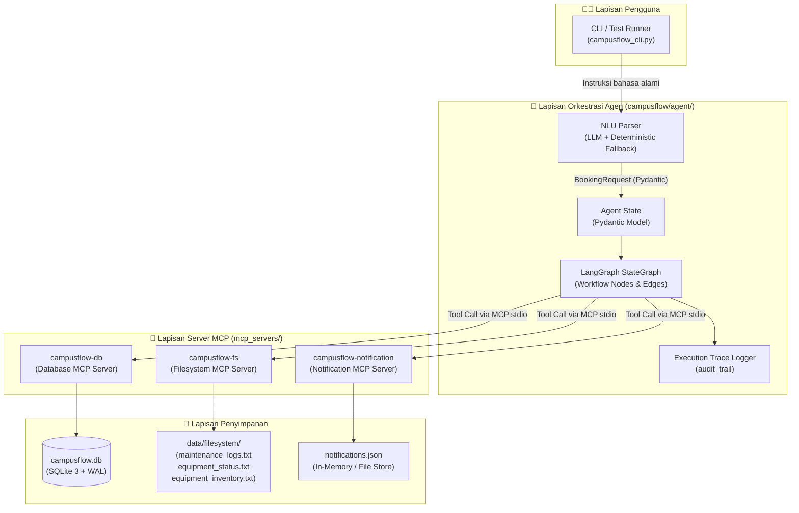
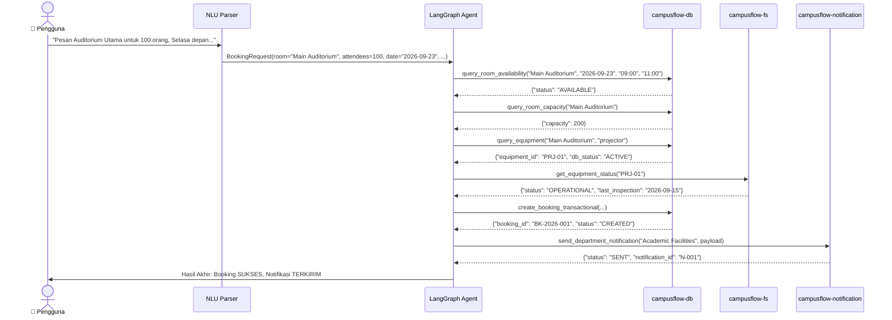
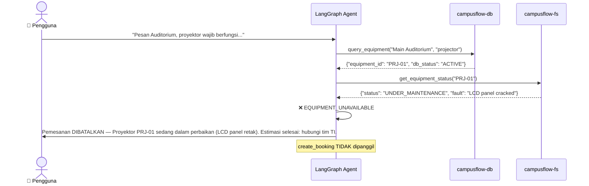
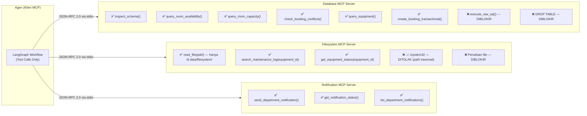
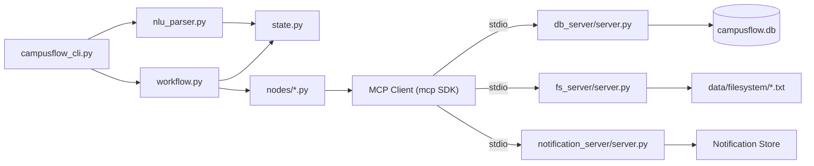

# Arsitektur Sistem: CampusFlow
**Academic Campus Facility & Event Coordinator**

Dokumen ini mendeskripsikan arsitektur keseluruhan sistem CampusFlow, termasuk batas-batas komponen, aliran data, lapisan keamanan, dan dependensi antar modul.

---

## 1. Gambaran Arsitektur Tingkat Tinggi

CampusFlow terdiri dari empat lapisan utama yang terpisah secara tanggung jawab:

```
┌────────────────────────────────────────────────────────────────┐
│                        LAPISAN PENGGUNA                        │
│          (CLI interaktif / Skrip pengujian otomatis)           │
└─────────────────────────┬──────────────────────────────────────┘
                          │  Bahasa alami / Perintah terstruktur
                          ▼
┌────────────────────────────────────────────────────────────────┐
│                    LAPISAN ORKESTRASI AGEN                     │
│              (LangGraph StateGraph + NLU Parser)               │
│                                                                │
│   ┌────────────┐  ┌─────────────┐  ┌──────────────────────┐  │
│   │ NLU Parser │  │ Agent State │  │ Execution Trace       │  │
│   │ (LLM/Deterministic)        │  │ (Audit Trail Logger) │  │
│   └────────────┘  └─────────────┘  └──────────────────────┘  │
└─────────────────────────┬──────────────────────────────────────┘
                          │  MCP JSON-RPC 2.0 via stdio
                          ▼
┌────────────────────────────────────────────────────────────────┐
│                    LAPISAN SERVER MCP                          │
│                                                                │
│  ┌──────────────────┐ ┌───────────────────┐ ┌──────────────┐ │
│  │  campusflow-db   │ │  campusflow-fs    │ │  campusflow- │ │
│  │  (Database MCP)  │ │  (Filesystem MCP) │ │notification) │ │
│  └────────┬─────────┘ └────────┬──────────┘ └──────┬───────┘ │
└───────────┼────────────────────┼───────────────────┼──────────┘
            │                    │                   │
            ▼                    ▼                   ▼
┌───────────────────┐ ┌──────────────────┐ ┌────────────────────┐
│  campusflow.db    │ │ data/filesystem/ │ │  Notif. Store      │
│  (SQLite 3 WAL)   │ │  *.txt log files │ │  (In-Memory/File)  │
└───────────────────┘ └──────────────────┘ └────────────────────┘
```

---

## 2. Diagram Komponen (Mermaid)



---

## 3. Batas Komponen & Tanggung Jawab

### 3.1 NLU Parser (`campusflow/agent/nlu_parser.py`)

| Aspek | Detail |
|---|---|
| **Tanggung Jawab** | Mengonversi instruksi bahasa alami menjadi skema `BookingRequest` terstruktur (Pydantic). |
| **Mode Operasi** | Dual-mode: (1) Model LLM eksternal jika API key tersedia; (2) Parser pola deterministik sebagai fallback. |
| **Input** | String teks bebas dari pengguna. |
| **Output** | `BookingRequest` (room_name, event_name, requester, date, start_time, end_time, attendee_count, required_equipment). |
| **Batasan** | Tidak boleh mengarang data yang hilang. Jika field wajib kosong, tandai status `NEEDS_CLARIFICATION`. |

### 3.2 Agent State (`campusflow/agent/state.py`)

| Aspek | Detail |
|---|---|
| **Tanggung Jawab** | Menyimpan seluruh konteks workflow dalam satu struktur data terstruktur. |
| **Model** | Pydantic `TypedDict`/`BaseModel` yang kompatibel dengan LangGraph. |
| **Mutabilitas** | Hanya diperbarui oleh node yang berwenang sesuai dengan transisi mesin status. |

### 3.3 LangGraph StateGraph (`campusflow/agent/workflow.py`)

| Aspek | Detail |
|---|---|
| **Tanggung Jawab** | Mengorkestrasi alur kerja pemesanan dengan graf status terarah. |
| **Simpul (*Nodes*)** | 10 simpul eksekusi + simpul kegagalan tunggal. |
| **Transisi (*Edges*)** | Conditional edges berdasarkan hasil validasi di `Agent State`. |
| **Jaminan** | Booking write tidak dapat dipanggil jika ada validasi yang belum lulus. |

### 3.4 MCP Servers (`mcp_servers/`)

| Server | Tanggung Jawab Utama | Tipe Akses |
|---|---|---|
| `campusflow-db` | Membaca/menulis data ruangan, jadwal, kapasitas, reservasi. | Baca + Tulis Terkontrol |
| `campusflow-fs` | Membaca log pemeliharaan dan status peralatan fisik. | Baca Saja (Sandbox) |
| `campusflow-notification` | Mengirim dan mencatat notifikasi departemen. | Tulis (Mock API) |

---

## 4. Aliran Data (*Data Flow*)

### 4.1 Aliran Data: Skenario Pemesanan Sukses



### 4.2 Aliran Data: Skenario Kegagalan Alat



---

## 5. Lapisan Keamanan (*Security Boundaries*)



---

## 6. Struktur Direktori Proyek

```text
CampusFlow/
├── .gitignore
├── PROJECT_CONTEXT.md
├── README.md
├── requirements.txt               # Dependensi Python terpin (diisi Fase 4)
├── pyproject.toml                 # Metadata proyek (diisi Fase 4)
│
├── prompts/
│   └── 00_MASTER_PROMPT.md       # Spesifikasi acuan
│
├── docs/                          # Dokumentasi Fase 1 & 2
│   ├── research.md
│   ├── problem-definition.md
│   ├── architecture-decisions.md
│   ├── architecture.md            ← (Dokumen ini)
│   ├── workflow.md
│   ├── state-machine.md
│   ├── data-model.md
│   ├── mcp-architecture.md
│   ├── mcp-database.md
│   ├── mcp-filesystem.md
│   ├── mcp-notification.md
│   └── testing.md
│
├── campusflow/                    # Paket Python utama agen
│   ├── __init__.py
│   ├── agent/
│   │   ├── __init__.py
│   │   ├── state.py               # Definisi AgentState (Pydantic)
│   │   ├── nlu_parser.py          # Parser bahasa alami
│   │   ├── workflow.py            # LangGraph StateGraph
│   │   ├── nodes/                 # Fungsi tiap simpul graf
│   │   │   ├── parse_request.py
│   │   │   ├── validate_requirements.py
│   │   │   ├── check_room.py
│   │   │   ├── validate_capacity.py
│   │   │   ├── check_equipment.py
│   │   │   ├── authorize_booking.py
│   │   │   ├── create_booking.py
│   │   │   ├── send_notification.py
│   │   │   ├── finalize_workflow.py
│   │   │   └── handle_failure.py
│   │   └── routing.py             # Peta routing departemen
│   └── config.py                  # Konfigurasi & env variables
│
├── mcp_servers/                   # Tiga server MCP mandiri
│   ├── db_server/
│   │   ├── __init__.py
│   │   └── server.py              # campusflow-db MCP Server
│   ├── fs_server/
│   │   ├── __init__.py
│   │   └── server.py              # campusflow-fs MCP Server
│   └── notification_server/
│       ├── __init__.py
│       └── server.py              # campusflow-notification MCP Server
│
├── data/
│   ├── database/
│   │   ├── schema.sql             # Skema database SQLite
│   │   ├── seed.sql               # Data awal (seed data)
│   │   └── campusflow.db          # File database runtime (di .gitignore)
│   └── filesystem/                # Dokumen operasional kampus (sandbox)
│       ├── maintenance_logs.txt
│       ├── equipment_status.txt
│       └── equipment_inventory.txt
│
├── tests/                         # Suite pengujian otomatis
│   ├── __init__.py
│   ├── conftest.py                # Fixtures pytest
│   ├── unit/
│   │   ├── test_nlu_parser.py
│   │   ├── test_state_model.py
│   │   └── test_db_queries.py
│   ├── integration/
│   │   ├── test_db_mcp.py
│   │   ├── test_fs_mcp.py
│   │   └── test_notification_mcp.py
│   └── e2e/
│       ├── test_01_successful_booking.py
│       ├── test_02_room_unavailable.py
│       ├── test_03_capacity_insufficient.py
│       ├── test_04_equipment_unavailable.py
│       ├── test_05_equipment_status_unknown.py
│       ├── test_06_database_failure.py
│       ├── test_07_notification_failure.py
│       ├── test_08_conflicting_evidence.py
│       ├── test_09_ambiguous_request.py
│       └── test_10_duplicate_booking.py
│
└── campusflow_cli.py              # Titik masuk CLI utama
```

---

## 7. Dependensi Komponen


