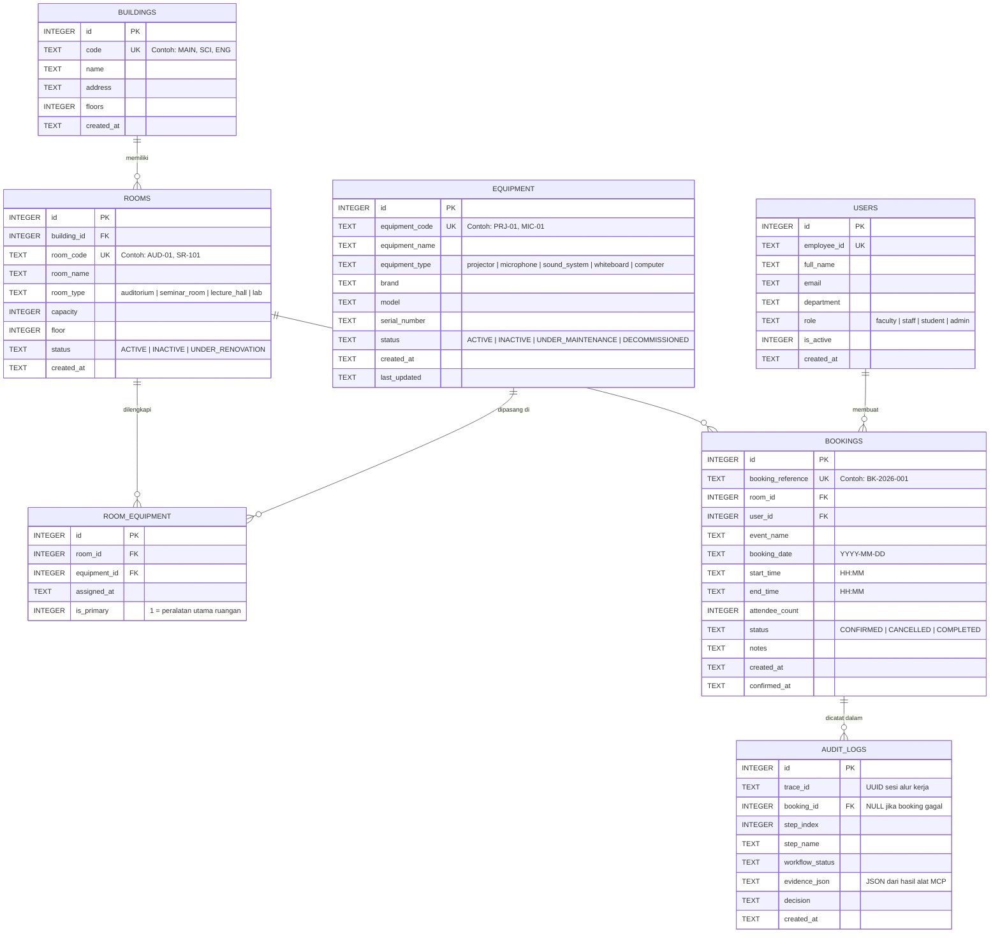

# Model Data: CampusFlow
**Spesifikasi Skema Database SQLite**

Dokumen ini mendefinisikan seluruh tabel, kolom, tipe data, constraint, relasi antar tabel, indeks, dan desain data awal (*seed data*) untuk database SQLite CampusFlow.

---

## 1. Diagram Relasi Entitas (ERD)



---

## 2. Definisi Skema SQL Lengkap

### Tabel: `buildings`
```sql
CREATE TABLE IF NOT EXISTS buildings (
    id          INTEGER PRIMARY KEY AUTOINCREMENT,
    code        TEXT    NOT NULL UNIQUE,      -- Kode singkat gedung
    name        TEXT    NOT NULL,             -- Nama lengkap gedung
    address     TEXT,
    floors      INTEGER NOT NULL DEFAULT 1,
    created_at  TEXT    NOT NULL DEFAULT (strftime('%Y-%m-%dT%H:%M:%SZ', 'now'))
);
```

### Tabel: `rooms`
```sql
CREATE TABLE IF NOT EXISTS rooms (
    id          INTEGER PRIMARY KEY AUTOINCREMENT,
    building_id INTEGER NOT NULL REFERENCES buildings(id) ON DELETE CASCADE,
    room_code   TEXT    NOT NULL UNIQUE,      -- Identifier unik ruangan
    room_name   TEXT    NOT NULL,
    room_type   TEXT    NOT NULL CHECK(room_type IN (
                    'auditorium', 'seminar_room', 'lecture_hall',
                    'conference_room', 'computer_lab', 'laboratory'
                )),
    capacity    INTEGER NOT NULL CHECK(capacity > 0),
    floor       INTEGER NOT NULL DEFAULT 1,
    status      TEXT    NOT NULL DEFAULT 'ACTIVE'
                        CHECK(status IN ('ACTIVE', 'INACTIVE', 'UNDER_RENOVATION')),
    created_at  TEXT    NOT NULL DEFAULT (strftime('%Y-%m-%dT%H:%M:%SZ', 'now'))
);
CREATE INDEX IF NOT EXISTS idx_rooms_building ON rooms(building_id);
CREATE INDEX IF NOT EXISTS idx_rooms_type ON rooms(room_type);
CREATE INDEX IF NOT EXISTS idx_rooms_capacity ON rooms(capacity);
```

### Tabel: `equipment`
```sql
CREATE TABLE IF NOT EXISTS equipment (
    id              INTEGER PRIMARY KEY AUTOINCREMENT,
    equipment_code  TEXT    NOT NULL UNIQUE,  -- ID unik alat, merujuk ke log fisik
    equipment_name  TEXT    NOT NULL,
    equipment_type  TEXT    NOT NULL CHECK(equipment_type IN (
                        'projector', 'microphone', 'sound_system',
                        'whiteboard', 'smartboard', 'computer',
                        'video_conferencing', 'air_conditioning', 'lighting'
                    )),
    brand           TEXT,
    model           TEXT,
    serial_number   TEXT,
    status          TEXT    NOT NULL DEFAULT 'ACTIVE'
                            CHECK(status IN (
                                'ACTIVE', 'INACTIVE',
                                'UNDER_MAINTENANCE', 'DECOMMISSIONED'
                            )),
    created_at      TEXT    NOT NULL DEFAULT (strftime('%Y-%m-%dT%H:%M:%SZ', 'now')),
    last_updated    TEXT    NOT NULL DEFAULT (strftime('%Y-%m-%dT%H:%M:%SZ', 'now'))
);
CREATE INDEX IF NOT EXISTS idx_equipment_type ON equipment(equipment_type);
CREATE INDEX IF NOT EXISTS idx_equipment_status ON equipment(status);
```

### Tabel: `room_equipment`
```sql
CREATE TABLE IF NOT EXISTS room_equipment (
    id              INTEGER PRIMARY KEY AUTOINCREMENT,
    room_id         INTEGER NOT NULL REFERENCES rooms(id) ON DELETE CASCADE,
    equipment_id    INTEGER NOT NULL REFERENCES equipment(id) ON DELETE CASCADE,
    is_primary      INTEGER NOT NULL DEFAULT 1 CHECK(is_primary IN (0, 1)),
    assigned_at     TEXT    NOT NULL DEFAULT (strftime('%Y-%m-%dT%H:%M:%SZ', 'now')),
    UNIQUE(room_id, equipment_id)              -- Satu alat satu kali per ruangan
);
CREATE INDEX IF NOT EXISTS idx_room_equipment_room ON room_equipment(room_id);
CREATE INDEX IF NOT EXISTS idx_room_equipment_equip ON room_equipment(equipment_id);
```

### Tabel: `users`
```sql
CREATE TABLE IF NOT EXISTS users (
    id          INTEGER PRIMARY KEY AUTOINCREMENT,
    employee_id TEXT    NOT NULL UNIQUE,
    full_name   TEXT    NOT NULL,
    email       TEXT    NOT NULL UNIQUE,
    department  TEXT    NOT NULL,
    role        TEXT    NOT NULL CHECK(role IN (
                    'faculty', 'staff', 'student', 'admin'
                )),
    is_active   INTEGER NOT NULL DEFAULT 1 CHECK(is_active IN (0, 1)),
    created_at  TEXT    NOT NULL DEFAULT (strftime('%Y-%m-%dT%H:%M:%SZ', 'now'))
);
```

### Tabel: `bookings`
```sql
CREATE TABLE IF NOT EXISTS bookings (
    id                  INTEGER PRIMARY KEY AUTOINCREMENT,
    booking_reference   TEXT    NOT NULL UNIQUE,  -- Format: BK-YYYY-NNN
    room_id             INTEGER NOT NULL REFERENCES rooms(id),
    user_id             INTEGER NOT NULL REFERENCES users(id),
    event_name          TEXT    NOT NULL,
    booking_date        TEXT    NOT NULL,           -- YYYY-MM-DD
    start_time          TEXT    NOT NULL,           -- HH:MM
    end_time            TEXT    NOT NULL,           -- HH:MM
    attendee_count      INTEGER NOT NULL CHECK(attendee_count > 0),
    status              TEXT    NOT NULL DEFAULT 'CONFIRMED'
                                CHECK(status IN ('CONFIRMED', 'CANCELLED', 'COMPLETED')),
    notes               TEXT,
    created_at          TEXT    NOT NULL DEFAULT (strftime('%Y-%m-%dT%H:%M:%SZ', 'now')),
    confirmed_at        TEXT,
    CHECK (start_time < end_time)                  -- Jam mulai harus sebelum jam selesai
);

-- Indeks pencegahan double-booking dan pencarian ketersediaan
CREATE INDEX IF NOT EXISTS idx_bookings_room_date
    ON bookings(room_id, booking_date, start_time, end_time)
    WHERE status = 'CONFIRMED';

CREATE INDEX IF NOT EXISTS idx_bookings_date
    ON bookings(booking_date);
```

### Tabel: `audit_logs`
```sql
CREATE TABLE IF NOT EXISTS audit_logs (
    id              INTEGER PRIMARY KEY AUTOINCREMENT,
    trace_id        TEXT    NOT NULL,          -- UUID sesi alur kerja
    booking_id      INTEGER REFERENCES bookings(id),  -- NULL jika booking gagal
    step_index      INTEGER NOT NULL,
    step_name       TEXT    NOT NULL,
    workflow_status TEXT    NOT NULL,
    evidence_json   TEXT,                      -- JSON string dari hasil alat MCP
    decision        TEXT,
    created_at      TEXT    NOT NULL DEFAULT (strftime('%Y-%m-%dT%H:%M:%SZ', 'now'))
);
CREATE INDEX IF NOT EXISTS idx_audit_trace ON audit_logs(trace_id);
CREATE INDEX IF NOT EXISTS idx_audit_booking ON audit_logs(booking_id);
```

---

## 3. PRAGMA & Konfigurasi Runtime

```sql
-- Aktifkan semua saat koneksi dibuka
PRAGMA foreign_keys = ON;
PRAGMA journal_mode = WAL;     -- Write-Ahead Logging untuk konkurensi
PRAGMA synchronous = NORMAL;   -- Keseimbangan keamanan vs. kinerja
PRAGMA busy_timeout = 5000;    -- Tunggu 5 detik jika DB terkunci
```

---

## 4. Rancangan Kueri Kritis

### Kueri 1: Cek Ketersediaan Ruangan (Conflict Detection)
```sql
-- Menggunakan logika interval tumpang-tindih:
-- Bentrok terjadi jika: existing.start < requested.end AND existing.end > requested.start
SELECT b.id, b.booking_reference, b.event_name, b.start_time, b.end_time
FROM   bookings b
WHERE  b.room_id       = :room_id
  AND  b.booking_date  = :booking_date
  AND  b.status        = 'CONFIRMED'
  AND  b.start_time    < :end_time
  AND  b.end_time      > :start_time;
-- Jika query mengembalikan 0 baris → AVAILABLE
-- Jika query mengembalikan >= 1 baris → UNAVAILABLE (sertakan detail bentrok)
```

### Kueri 2: Penulisan Booking Transaksional (Race-Condition Safe)
```sql
BEGIN IMMEDIATE TRANSACTION;

-- Re-validasi bentrok di dalam transaksi yang sama
SELECT COUNT(*) AS conflict_count
FROM   bookings
WHERE  room_id      = :room_id
  AND  booking_date = :booking_date
  AND  status       = 'CONFIRMED'
  AND  start_time   < :end_time
  AND  end_time     > :start_time;

-- Hanya INSERT jika conflict_count = 0 (dilakukan oleh kode Python)
INSERT INTO bookings (
    booking_reference, room_id, user_id, event_name,
    booking_date, start_time, end_time, attendee_count,
    status, confirmed_at
) VALUES (
    :booking_reference, :room_id, :user_id, :event_name,
    :booking_date, :start_time, :end_time, :attendee_count,
    'CONFIRMED', strftime('%Y-%m-%dT%H:%M:%SZ', 'now')
);

COMMIT;
```

---

## 5. Data Awal (*Seed Data*) — Gambaran Representasi

### Gedung
| code | name | floors |
|---|---|---|
| `MAIN` | Gedung Utama Kampus | 4 |
| `SCI` | Gedung Ilmu Pengetahuan | 5 |
| `ENG` | Gedung Teknik | 3 |

### Ruangan
| room_code | room_name | room_type | capacity | status |
|---|---|---|---|---|
| `AUD-01` | Auditorium Utama | auditorium | 300 | ACTIVE |
| `SR-101` | Ruang Seminar 101 | seminar_room | 50 | ACTIVE |
| `SR-102` | Ruang Seminar 102 | seminar_room | 50 | ACTIVE |
| `LH-201` | Ruang Kuliah 201 | lecture_hall | 80 | ACTIVE |
| `CR-301` | Ruang Konferensi 301 | conference_room | 20 | ACTIVE |
| `LAB-401` | Laboratorium Komputer | computer_lab | 40 | UNDER_RENOVATION |

### Peralatan
| equipment_code | equipment_name | equipment_type | status |
|---|---|---|---|
| `PRJ-01` | Proyektor EPSON EB-L615U | projector | ACTIVE |
| `PRJ-02` | Proyektor BenQ LU930 | projector | UNDER_MAINTENANCE |
| `PRJ-03` | Proyektor Auditorium ViewSonic | projector | ACTIVE |
| `MIC-01` | Mikrofon Wireless Shure ULXD | microphone | ACTIVE |
| `MIC-02` | Mikrofon Kabel Audio-Technica | microphone | ACTIVE |
| `SND-01` | Sound System Auditorium JBL | sound_system | ACTIVE |

### Penugasan Alat ke Ruangan
| Ruangan | Alat |
|---|---|
| `AUD-01` (Auditorium Utama) | `PRJ-03`, `MIC-01`, `SND-01` |
| `SR-101` (Seminar 101) | `PRJ-01`, `MIC-02` |
| `SR-102` (Seminar 102) | `PRJ-02`, `MIC-02` |
| `LH-201` (Kuliah 201) | `PRJ-01` |

### Reservasi Awal (Untuk Membuat Skenario Bentrok)
| Ruangan | Tanggal | Jam | Acara | Status |
|---|---|---|---|---|
| `AUD-01` | `2026-09-23` | 09:00–11:00 | Workshop AI (Pertemuan 1) | CONFIRMED |
| `SR-101` | `2026-09-23` | 13:00–15:00 | Rapat Evaluasi Program | CONFIRMED |
| `AUD-01` | `2026-09-24` | 09:00–17:00 | Seminar Nasional Hari Penuh | CONFIRMED |
