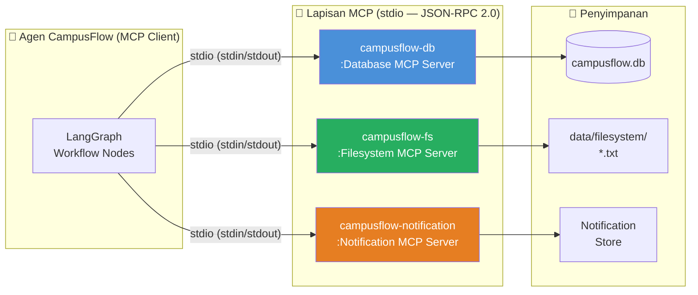

# Arsitektur MCP: CampusFlow
**Spesifikasi Tiga Server Model Context Protocol**

Dokumen ini mendefinisikan arsitektur menyeluruh ketiga server MCP yang digunakan CampusFlow: tujuan, alat yang disediakan, format input/output, penanganan galat, izin akses, dan perilaku keamanan masing-masing server.

---

## 1. Arsitektur Komunikasi MCP



Setiap server MCP dijalankan sebagai **proses Python terpisah** dan berkomunikasi dengan agen melalui **stdin/stdout (stdio)**. Tidak ada socket jaringan yang dibuka. Setiap server memiliki batas akses (*permission boundary*) yang terisolasi sepenuhnya.

---

## 2. Server MCP 1: `campusflow-db` (Database MCP)

### 2.1 Tujuan
Memberikan agen akses terkontrol ke database SQLite CampusFlow untuk membaca informasi ruangan, kapasitas, jadwal, peralatan, dan menulis reservasi melalui transaksi yang aman.

### 2.2 Izin Akses
| Operasi | Diizinkan |
|---|---|
| Membaca skema tabel | ✅ |
| Membaca data ruangan & kapasitas | ✅ |
| Memeriksa bentrok jadwal | ✅ |
| Membaca data peralatan | ✅ |
| Menulis reservasi baru (transaksional) | ✅ |
| Eksekusi SQL mentah sembarangan | ❌ |
| Mengubah / menghapus tabel | ❌ |
| Membaca atau memodifikasi tabel yang tidak terkait | ❌ |

### 2.3 Katalog Alat (*Tool Catalog*)

#### `inspect_schema()`
- **Deskripsi:** Mengembalikan daftar tabel dan kolom dalam database.
- **Input:** Tidak ada parameter.
- **Output:** `{"tables": [{"name": "rooms", "columns": ["id", "room_code", ...]}, ...]}`
- **Perilaku Galat:** Mengembalikan pesan kesalahan terstruktur jika database tidak dapat dibuka.

---

#### `query_room_availability(room_name, booking_date, start_time, end_time)`
- **Deskripsi:** Memeriksa apakah ruangan tersedia pada waktu yang diminta dengan mencari bentrok reservasi.
- **Input:**
  ```json
  {
    "room_name": "Auditorium Utama",
    "booking_date": "2026-09-23",
    "start_time": "09:00",
    "end_time": "11:00"
  }
  ```
- **Output Tersedia:**
  ```json
  {
    "status": "AVAILABLE",
    "room_id": 1,
    "room_code": "AUD-01",
    "room_name": "Auditorium Utama",
    "conflicts": []
  }
  ```
- **Output Tidak Tersedia:**
  ```json
  {
    "status": "UNAVAILABLE",
    "room_id": 1,
    "room_code": "AUD-01",
    "room_name": "Auditorium Utama",
    "conflicts": [
      {
        "booking_reference": "BK-2026-001",
        "event_name": "Workshop AI",
        "start_time": "09:00",
        "end_time": "11:00"
      }
    ]
  }
  ```
- **Output Tidak Ditemukan:**
  ```json
  {"status": "NOT_FOUND", "message": "Ruangan 'Auditorium Utama' tidak ditemukan dalam database."}
  ```

---

#### `query_room_capacity(room_name)`
- **Deskripsi:** Mengambil kapasitas maksimum ruangan.
- **Input:** `{"room_name": "Auditorium Utama"}`
- **Output:** `{"room_id": 1, "room_code": "AUD-01", "room_name": "Auditorium Utama", "capacity": 300, "room_type": "auditorium"}`

---

#### `check_booking_conflicts(room_id, booking_date, start_time, end_time)`
- **Deskripsi:** Kueri bentrok yang lebih presisi menggunakan `room_id` numerik internal.
- **Input:** `{"room_id": 1, "booking_date": "2026-09-23", "start_time": "09:00", "end_time": "11:00"}`
- **Output:** `{"has_conflict": false, "conflicts": []}`

---

#### `query_equipment(room_name, equipment_type)`
- **Deskripsi:** Mencari peralatan bertipe tertentu yang terpasang di ruangan.
- **Input:** `{"room_name": "Auditorium Utama", "equipment_type": "projector"}`
- **Output:**
  ```json
  {
    "found": true,
    "equipment": [
      {
        "equipment_id": 3,
        "equipment_code": "PRJ-03",
        "equipment_name": "Proyektor Auditorium ViewSonic",
        "equipment_type": "projector",
        "db_status": "ACTIVE",
        "is_primary": 1
      }
    ]
  }
  ```

---

#### `create_booking_transactional(room_id, user_identifier, event_name, booking_date, start_time, end_time, attendee_count)`
- **Deskripsi:** Menulis reservasi baru ke database dalam transaksi ACID yang terisolasi. Memeriksa ulang bentrok di dalam transaksi sebelum menulis.
- **Input:**
  ```json
  {
    "room_id": 1,
    "user_identifier": "FAC-001",
    "event_name": "Workshop AI 100 Orang",
    "booking_date": "2026-09-23",
    "start_time": "13:00",
    "end_time": "15:00",
    "attendee_count": 100
  }
  ```
- **Output Sukses:**
  ```json
  {
    "status": "CREATED",
    "booking_id": 4,
    "booking_reference": "BK-2026-004",
    "confirmed_at": "2026-09-21T13:45:00Z"
  }
  ```
- **Output Konflik (Race Condition Terdeteksi):**
  ```json
  {
    "status": "CONFLICT_DETECTED",
    "message": "Reservasi gagal: terdeteksi bentrok jadwal saat transaksi berlangsung.",
    "conflicts": [...]
  }
  ```
- **Output Galat Database:**
  ```json
  {"status": "DATABASE_ERROR", "message": "...pesan teknis..."}
  ```

---

## 3. Server MCP 2: `campusflow-fs` (Filesystem MCP)

### 3.1 Tujuan
Memberikan agen akses baca-saja (*read-only*) ke file catatan operasional kampus yang tersimpan di folder `data/filesystem/`, untuk memverifikasi status fisik dan riwayat pemeliharaan peralatan secara independen dari database.

### 3.2 Izin Akses
| Operasi | Diizinkan |
|---|---|
| Membaca file di `data/filesystem/` | ✅ |
| Mencari teks dalam log pemeliharaan | ✅ |
| Menulis / mengubah file apapun | ❌ |
| Mengakses path di luar sandbox | ❌ |
| Traversal direktori (`../../`) | ❌ |

### 3.3 Format File Operasional

#### `maintenance_logs.txt` — Catatan Pemeliharaan dan Servis
```text
[2026-09-15] PRJ-01 | STATUS: OPERATIONAL | Inspeksi rutin selesai. Lampu diganti baru. Teknisi: Ahmad Fauzi. Tidak ada catatan kerusakan aktif.
[2026-09-10] PRJ-02 | STATUS: UNDER_MAINTENANCE | LCD panel retak. Menunggu suku cadang dari distributor. ETA: 2 minggu. PIC: Tim TI Pusat.
[2026-09-18] PRJ-03 | STATUS: OPERATIONAL | Uji coba pra-acara untuk Seminar Nasional berhasil. Proyektor berfungsi normal.
[2026-09-12] MIC-01 | STATUS: OPERATIONAL | Baterai diganti, sinyal kuat. Tidak ada interferensi.
[2026-09-20] SND-01 | STATUS: OPERATIONAL | Kalibrasi volume speaker selesai. Siap pakai.
```

#### `equipment_status.txt` — Status Operasional Terkini
```text
PRJ-01 | OPERATIONAL    | Terakhir diperbarui: 2026-09-15
PRJ-02 | UNDER_MAINTENANCE | Terakhir diperbarui: 2026-09-10
PRJ-03 | OPERATIONAL    | Terakhir diperbarui: 2026-09-18
MIC-01 | OPERATIONAL    | Terakhir diperbarui: 2026-09-12
MIC-02 | OPERATIONAL    | Terakhir diperbarui: 2026-09-01
SND-01 | OPERATIONAL    | Terakhir diperbarui: 2026-09-20
```

#### `equipment_inventory.txt` — Inventaris Peralatan Lengkap
```text
PRJ-01 | Proyektor EPSON EB-L615U | SN:EP2024-001 | Lokasi: SR-101 | Thn Beli: 2024
PRJ-02 | Proyektor BenQ LU930     | SN:BQ2023-002 | Lokasi: SR-102 | Thn Beli: 2023
PRJ-03 | Proyektor ViewSonic PA503X| SN:VS2022-003 | Lokasi: AUD-01 | Thn Beli: 2022
MIC-01 | Mikrofon Wireless Shure   | SN:SH2024-001 | Lokasi: AUD-01 | Thn Beli: 2024
MIC-02 | Mikrofon AT4022           | SN:AT2023-001 | Lokasi: SR-101 | Thn Beli: 2023
SND-01 | Sound System JBL PRX800   | SN:JB2021-001 | Lokasi: AUD-01 | Thn Beli: 2021
```

### 3.4 Katalog Alat (*Tool Catalog*)

#### `get_equipment_status(equipment_code)`
- **Deskripsi:** Membaca status operasional terkini alat berdasarkan kode alat dari `equipment_status.txt`.
- **Input:** `{"equipment_code": "PRJ-01"}`
- **Output Ditemukan:**
  ```json
  {
    "found": true,
    "equipment_code": "PRJ-01",
    "status": "OPERATIONAL",
    "last_updated": "2026-09-15"
  }
  ```
- **Output Tidak Ditemukan:**
  ```json
  {"found": false, "equipment_code": "PRJ-99", "status": "UNKNOWN", "message": "Kode alat tidak ditemukan dalam catatan status."}
  ```

---

#### `search_maintenance_log(equipment_code)`
- **Deskripsi:** Mencari seluruh entri yang berkaitan dengan alat tertentu dalam `maintenance_logs.txt`.
- **Input:** `{"equipment_code": "PRJ-02"}`
- **Output:**
  ```json
  {
    "equipment_code": "PRJ-02",
    "log_entries": [
      {
        "date": "2026-09-10",
        "status": "UNDER_MAINTENANCE",
        "note": "LCD panel retak. Menunggu suku cadang dari distributor. ETA: 2 minggu.",
        "technician": "Tim TI Pusat"
      }
    ]
  }
  ```

---

#### `read_file(filename)`
- **Deskripsi:** Membaca seluruh isi satu file operasional dari sandbox.
- **Input:** `{"filename": "equipment_inventory.txt"}`
- **Validasi Keamanan:**
  - Hanya menerima nama file tanpa path (tanpa `/` atau `\`).
  - File harus berada di dalam `data/filesystem/`.
  - Gagal dengan pesan galat jika file tidak ditemukan atau path tidak aman.
- **Output:** `{"filename": "equipment_inventory.txt", "content": "...isi file..."}`

---

## 4. Server MCP 3: `campusflow-notification` (Notification MCP)

### 4.1 Tujuan
Menyimulasikan sistem pengiriman pesan internal kampus kepada departemen-departemen terkait setelah proses reservasi selesai atau jika terjadi eskalasi masalah.

### 4.2 Tabel Perutean Departemen
| Departemen (`department_key`) | Nama Tampilan | Alamat (Simulasi) | Aktivasi |
|---|---|---|---|
| `academic_facilities` | Fasilitas Akademik | facilities@campusflow.test | Sukses reservasi ruangan |
| `it_support` | Dukungan TI & Multimedia | it.support@campusflow.test | Masalah alat / kebutuhan alat khusus |
| `maintenance` | Pemeliharaan & Perbaikan | maintenance@campusflow.test | Kerusakan fisik / eskalasi |
| `event_affairs` | Biro Acara & Protokoler | events@campusflow.test | Eskalasi koordinasi acara besar |

### 4.3 Katalog Alat (*Tool Catalog*)

#### `send_department_notification(department_key, subject, payload, booking_id)`
- **Deskripsi:** Mengirim notifikasi terstruktur ke departemen yang ditentukan.
- **Input:**
  ```json
  {
    "department_key": "academic_facilities",
    "subject": "Konfirmasi Reservasi: Workshop AI — Auditorium Utama",
    "payload": {
      "booking_reference": "BK-2026-004",
      "room_name": "Auditorium Utama",
      "event_name": "Workshop AI 100 Orang",
      "booking_date": "2026-09-23",
      "start_time": "13:00",
      "end_time": "15:00",
      "attendee_count": 100,
      "requester": "Dr. Sari Dewi",
      "equipment_status": "OPERATIONAL"
    },
    "booking_id": 4
  }
  ```
- **Output Sukses:**
  ```json
  {
    "status": "SENT",
    "notification_id": "N-2026-001",
    "department": "Fasilitas Akademik",
    "sent_at": "2026-09-21T13:45:30Z"
  }
  ```
- **Output Gagal (untuk pengujian skenario kegagalan):**
  ```json
  {"status": "FAILED", "message": "Layanan notifikasi tidak merespons (timeout)."}
  ```

---

#### `get_notification_status(notification_id)`
- **Deskripsi:** Mengambil status pengiriman notifikasi berdasarkan ID notifikasi.
- **Input:** `{"notification_id": "N-2026-001"}`
- **Output:** `{"notification_id": "N-2026-001", "status": "SENT", "department": "Fasilitas Akademik", "sent_at": "..."}`

---

#### `list_department_notifications(department_key, limit)`
- **Deskripsi:** Mengambil riwayat notifikasi yang dikirimkan ke departemen tertentu.
- **Input:** `{"department_key": "academic_facilities", "limit": 10}`
- **Output:** `{"department": "Fasilitas Akademik", "total": 3, "notifications": [...]}`

---

## 5. Protokol Penanganan Galat MCP (Lintas Server)

Setiap server MCP mengikuti format respons kesalahan yang konsisten:

```json
{
  "error": true,
  "error_code": "TOOL_EXECUTION_ERROR | DATABASE_UNAVAILABLE | FILE_NOT_FOUND | PERMISSION_DENIED | INVALID_INPUT",
  "message": "Deskripsi teknis kesalahan yang terjadi.",
  "tool_name": "nama_alat_yang_dipanggil",
  "timestamp": "2026-09-21T13:45:00Z"
}
```

Agen wajib memperlakukan respons galat ini sebagai status `ERROR` dalam `AgentState` dan melanjutkan ke jalur kegagalan yang sesuai — **tidak pernah menganggap galat sebagai sinyal keberhasilan**.
