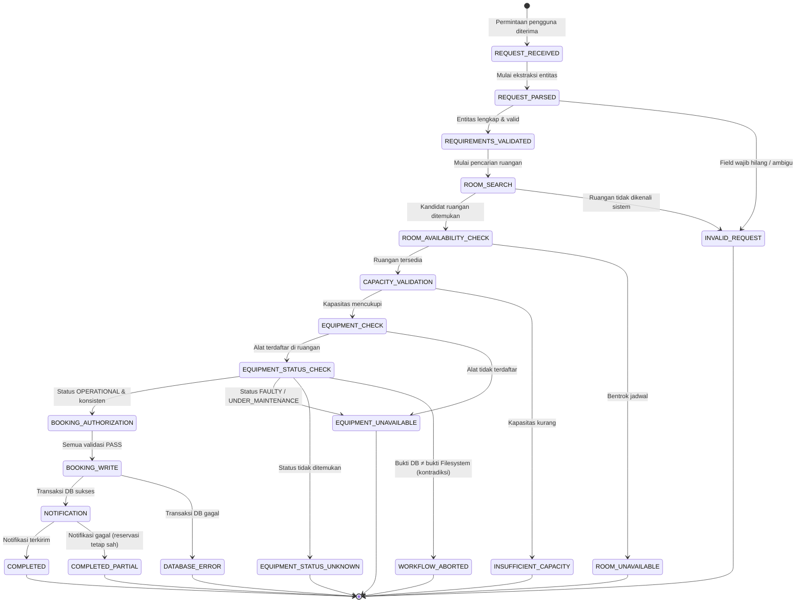

# Spesifikasi Mesin Status: CampusFlow
**LangGraph State Machine — Simpul, Transisi, dan Jaminan Keamanan**

Dokumen ini mendefinisikan secara presisi seluruh simpul (*nodes*), kondisi perpindahan (*conditional edges*), nilai status yang valid, dan jaminan keamanan (*safety invariants*) dari mesin status LangGraph CampusFlow.

---

## 1. Diagram Mesin Status (State Machine Diagram)



---

## 2. Daftar Simpul (*Node Registry*)

| Nama Simpul (Fungsi) | File Implementasi | Peran | Alat MCP yang Digunakan |
|---|---|---|---|
| `parse_request` | `nodes/parse_request.py` | Mengekstrak entitas dari teks bebas pengguna | NLU Parser |
| `validate_requirements` | `nodes/validate_requirements.py` | Memvalidasi dan menormalkan seluruh entitas | Tidak ada (deterministik) |
| `check_room` | `nodes/check_room.py` | Memeriksa ketersediaan ruangan di database | `campusflow-db` |
| `validate_capacity` | `nodes/validate_capacity.py` | Membandingkan jumlah peserta dengan kapasitas ruangan | `campusflow-db` |
| `check_equipment` | `nodes/check_equipment.py` | Mencari dan memvalidasi peralatan wajib di database | `campusflow-db` |
| `authorize_booking` | `nodes/authorize_booking.py` | Memeriksa status fisik alat via catatan pemeliharaan | `campusflow-fs` |
| `create_booking` | `nodes/create_booking.py` | Menulis reservasi ke database secara transaksional | `campusflow-db` |
| `send_notification` | `nodes/send_notification.py` | Mengirim notifikasi ke departemen yang tepat | `campusflow-notification` |
| `finalize_workflow` | `nodes/finalize_workflow.py` | Menyusun respons akhir dan menyimpan jejak audit | Tidak ada |
| `handle_failure` | `nodes/handle_failure.py` | Menangani semua jalur kegagalan secara terstruktur | Tidak ada |

---

## 3. Struktur Agent State (Pydantic Model)

```python
from typing import TypedDict, Optional, List, Literal, Any
from datetime import date, time

# Status yang diizinkan
WorkflowStatus = Literal[
    "REQUEST_RECEIVED", "REQUEST_PARSED", "REQUIREMENTS_VALIDATED",
    "ROOM_SEARCH", "ROOM_AVAILABILITY_CHECK", "CAPACITY_VALIDATION",
    "EQUIPMENT_CHECK", "EQUIPMENT_STATUS_CHECK", "BOOKING_AUTHORIZATION",
    "BOOKING_WRITE", "NOTIFICATION", "COMPLETED", "COMPLETED_PARTIAL",
    "INVALID_REQUEST", "ROOM_UNAVAILABLE", "INSUFFICIENT_CAPACITY",
    "EQUIPMENT_UNAVAILABLE", "EQUIPMENT_STATUS_UNKNOWN",
    "WORKFLOW_ABORTED", "DATABASE_ERROR", "NOTIFICATION_ERROR"
]

ResourceStatus = Literal["AVAILABLE", "UNAVAILABLE", "UNKNOWN", "ERROR"]
EquipmentStatus = Literal["OPERATIONAL", "UNDER_MAINTENANCE", "FAULTY", "UNKNOWN", "CONFLICT", "NOT_FOUND"]
NotificationStatus = Literal["SENT", "FAILED", "PENDING", "NOT_REQUIRED"]

class BookingRequest(TypedDict):
    """Permintaan pemesanan yang sudah diurai dari teks pengguna."""
    room_name: str
    event_name: str
    requester: str
    booking_date: str            # Format: YYYY-MM-DD
    start_time: str              # Format: HH:MM
    end_time: str                # Format: HH:MM
    attendee_count: int
    required_equipment: List[str]  # ["projector", "microphone", ...]
    notification_targets: List[str]

class ValidationResult(TypedDict):
    passed: bool
    reason: Optional[str]
    details: Optional[Any]

class AuditStep(TypedDict):
    step_index: int
    timestamp: str               # ISO 8601
    step_name: str
    evidence: Any                # Bukti mentah dari alat MCP
    decision: str
    next_state: str

class AgentState(TypedDict):
    # --- Permintaan & Pemohon ---
    request_raw: str
    parsed_request: Optional[BookingRequest]

    # --- Informasi Ruangan ---
    candidate_rooms: List[dict]
    selected_room: Optional[dict]

    # --- Hasil Validasi ---
    room_availability: Optional[ResourceStatus]
    room_availability_details: Optional[dict]
    capacity_validation: Optional[ValidationResult]
    equipment_results: Optional[List[dict]]
    equipment_status: Optional[EquipmentStatus]
    equipment_status_details: Optional[dict]

    # --- Validasi Akhir ---
    all_validations_passed: bool
    booking_authorized: bool

    # --- Hasil Booking ---
    booking_id: Optional[str]

    # --- Notifikasi ---
    notification_status: Optional[NotificationStatus]
    notification_details: Optional[dict]

    # --- Kontrol Alur Kerja ---
    workflow_status: WorkflowStatus
    errors: List[str]

    # --- Jejak Audit ---
    trace_id: str
    audit_trail: List[AuditStep]
```

---

## 4. Definisi Conditional Edges

Semua transisi bersyarat diimplementasikan sebagai fungsi Python murni yang membaca `AgentState` dan mengembalikan nama simpul tujuan berikutnya.

```python
def route_after_parse(state: AgentState) -> str:
    if state["workflow_status"] == "INVALID_REQUEST":
        return "handle_failure"
    return "validate_requirements"

def route_after_room_check(state: AgentState) -> str:
    if state["room_availability"] != "AVAILABLE":
        return "handle_failure"
    return "validate_capacity"

def route_after_capacity(state: AgentState) -> str:
    if not state["capacity_validation"]["passed"]:
        return "handle_failure"
    return "check_equipment"

def route_after_equipment_check(state: AgentState) -> str:
    # Tidak ada alat ditemukan
    if not state["equipment_results"]:
        return "handle_failure"
    return "authorize_booking"   # = equipment_status_check node

def route_after_equipment_status(state: AgentState) -> str:
    status = state["equipment_status"]
    if status == "CONFLICT":
        return "handle_failure"  # → WORKFLOW_ABORTED
    if status in ("UNDER_MAINTENANCE", "FAULTY", "NOT_FOUND"):
        return "handle_failure"  # → EQUIPMENT_UNAVAILABLE
    if status == "UNKNOWN":
        return "handle_failure"  # → EQUIPMENT_STATUS_UNKNOWN
    return "create_booking"      # status == "OPERATIONAL"

def route_after_booking(state: AgentState) -> str:
    if state["booking_id"] is None:
        return "handle_failure"  # → DATABASE_ERROR
    return "send_notification"

def route_after_notification(state: AgentState) -> str:
    return "finalize_workflow"   # selalu lanjut; kegagalan notif ditangani di finalize
```

---

## 5. Jaminan Keamanan Mesin Status (*Safety Invariants*)

> [!IMPORTANT]
> Jaminan ini adalah kontrak tidak bisa dilanggar yang dijamin oleh struktur mesin status itu sendiri — bukan sekedar panduan.

### INV-001: Booking Write hanya dapat dipanggil dari `create_booking` node
- Fungsi `create_booking_transactional()` (Database MCP) hanya dipanggil dari simpul `create_booking`.
- Simpul `create_booking` hanya dapat dicapai melalui tepi bersyarat `route_after_equipment_status` dengan kondisi: `equipment_status == "OPERATIONAL"`.
- Ini menjamin bahwa penulisan ke database **secara struktural tidak mungkin** terjadi jika validasi belum selesai.

### INV-002: UNKNOWN ≠ AVAILABLE
- Dalam fungsi `route_after_equipment_status`, kondisi `status == "UNKNOWN"` selalu diarahkan ke `handle_failure`, bukan ke `create_booking`.
- Status `UNKNOWN` tidak pernah dapat diinterpretasikan sebagai lolos validasi.

### INV-003: Kegagalan Notifikasi tidak menyebabkan Rollback Database
- Setelah `create_booking` sukses dan `booking_id` diisi, kegagalan di simpul `send_notification` tidak memicu rollback transaksi database.
- Simpul `finalize_workflow` membaca `notification_status` dan menetapkan workflow_status `COMPLETED_PARTIAL` jika notifikasi gagal.

### INV-004: Kontradiksi Bukti Menyebabkan Pembatalan Total
- Jika `equipment_status == "CONFLICT"` (database menyatakan `ACTIVE` tetapi filesystem menyatakan `FAULTY`), seluruh alur kerja dibatalkan dengan status `WORKFLOW_ABORTED` dan tidak ada penulisan ke database.

### INV-005: Tidak ada Fabricasi Data
- Setiap nilai dalam `AgentState` yang berkaitan dengan validasi harus berasal dari hasil nyata alat MCP — bukan dari asumsi LLM.
- Simpul yang tidak menerima respons valid dari alat MCP wajib menetapkan status `UNKNOWN` atau `ERROR`, tidak boleh membuat nilai default yang terlihat berhasil.

---

## 6. Tabel Lengkap Status & Nilai Terakhir

| `workflow_status` | `booking_id` | `notification_status` | Makna |
|---|---|---|---|
| `COMPLETED` | Ada | `SENT` | Reservasi sukses, notifikasi terkirim |
| `COMPLETED_PARTIAL` | Ada | `FAILED` | Reservasi sukses, notifikasi gagal |
| `INVALID_REQUEST` | Tidak ada | Tidak ada | Data permintaan tidak lengkap / ambigu |
| `ROOM_UNAVAILABLE` | Tidak ada | Tidak ada | Ruangan bentrok / tidak tersedia |
| `INSUFFICIENT_CAPACITY` | Tidak ada | Tidak ada | Kapasitas ruangan tidak cukup |
| `EQUIPMENT_UNAVAILABLE` | Tidak ada | Tidak ada | Alat tidak ada / rusak / dalam perbaikan |
| `EQUIPMENT_STATUS_UNKNOWN` | Tidak ada | Tidak ada | Status fisik alat tidak dapat diverifikasi |
| `WORKFLOW_ABORTED` | Tidak ada | Tidak ada | Bukti database dan filesystem bertentangan |
| `DATABASE_ERROR` | Tidak ada | Tidak ada | Galat teknis saat transaksi penulisan |
