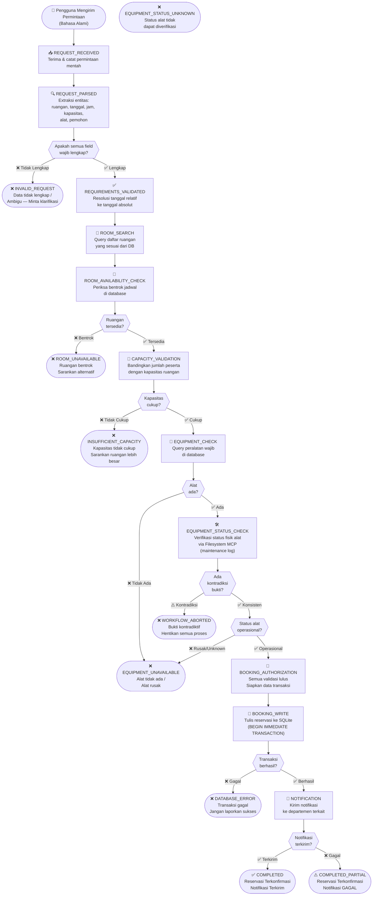

# Alur Kerja Sistem: CampusFlow
**Workflow Pemrosesan Permintaan Pemesanan Fasilitas Kampus**

Dokumen ini mendeskripsikan alur kerja lengkap dari momen pengguna mengirim instruksi bahasa alami hingga sistem menghasilkan respons akhir—baik berupa konfirmasi pemesanan sukses maupun laporan kegagalan yang terstruktur.

---

## 1. Peta Alur Kerja Keseluruhan

---

## 2. Deskripsi Detail Setiap Tahapan

### Tahap 1 — REQUEST_RECEIVED
- **Apa yang terjadi:** Sistem menerima teks permintaan mentah dari pengguna dan membuat entri jejak audit baru dengan UUID unik untuk sesi ini.
- **Alat yang digunakan:** Tidak ada (operasi internal).
- **Perubahan State:** `request_raw` diisi, `trace_id` dibuat, `workflow_status` ← `REQUEST_RECEIVED`.

---

### Tahap 2 — REQUEST_PARSED
- **Apa yang terjadi:** NLU Parser mengekstrak entitas-entitas penting dari teks permintaan.
  - Nama ruangan / jenis ruangan.
  - Nama acara dan pemohon.
  - Tanggal (termasuk resolusi waktu relatif: "Selasa depan" → `2026-09-22`).
  - Jam mulai dan jam selesai.
  - Jumlah peserta.
  - Jenis peralatan yang dibutuhkan.
  - Departemen yang harus diberitahu.
- **Aturan:** Jika salah satu field wajib tidak dapat diekstrak dengan kepastian, sistem wajib berhenti dan melaporkan status `INVALID_REQUEST` beserta daftar informasi yang kurang.
- **Alat yang digunakan:** NLU Parser (LLM atau Deterministic Fallback).
- **Perubahan State:** `parsed_request` (BookingRequest Pydantic) diisi.

---

### Tahap 3 — REQUIREMENTS_VALIDATED
- **Apa yang terjadi:** Sistem memvalidasi format seluruh entitas yang sudah diekstrak:
  - Tanggal dikonversi ke format ISO 8601 (`YYYY-MM-DD`).
  - Waktu divalidasi dalam format `HH:MM` dengan jam operasional valid (07:00–22:00).
  - Jumlah peserta adalah bilangan bulat positif.
- **Alat yang digunakan:** Logika program deterministik (tidak menggunakan LLM atau MCP).
- **Perubahan State:** `requirements_validated` ← `True`.

---

### Tahap 4 — ROOM_SEARCH
- **Apa yang terjadi:** Sistem meminta daftar ruangan yang cocok dari database berdasarkan nama atau tipe yang disebutkan pengguna.
- **Alat yang digunakan:** `campusflow-db` → `inspect_schema()` + `query_room_capacity()`.
- **Perubahan State:** `candidate_rooms` diisi dengan daftar opsi ruangan yang memenuhi filter.

---

### Tahap 5 — ROOM_AVAILABILITY_CHECK
- **Apa yang terjadi:** Sistem memeriksa apakah ruangan yang diminta tidak memiliki bentrok reservasi di database untuk rentang tanggal dan jam yang diminta.
- **Logika Pendeteksian Bentrok:**
  - Ruangan dianggap **TERSEDIA** jika tidak ada reservasi aktif dengan kondisi: `existing.start_time < requested.end_time AND existing.end_time > requested.start_time`.
- **Alat yang digunakan:** `campusflow-db` → `check_booking_conflicts()`.
- **Perubahan State:** `room_availability` ← `{status: "AVAILABLE" | "UNAVAILABLE", conflicts: [...]}`.

---

### Tahap 6 — CAPACITY_VALIDATION
- **Apa yang terjadi:** Sistem mengambil kapasitas maksimum ruangan dari database dan membandingkannya dengan jumlah peserta yang diminta.
- **Logika:** `attendee_count <= room.capacity` → Lulus; sebaliknya → Gagal.
- **Alat yang digunakan:** `campusflow-db` → `query_room_capacity()`.
- **Perubahan State:** `capacity_validation` ← `{status: "PASS" | "FAIL", room_capacity: N, requested: M}`.

---

### Tahap 7 — EQUIPMENT_CHECK
- **Apa yang terjadi:** Sistem mengambil data peralatan yang terdaftar di ruangan tersebut dari database dan memverifikasi apakah jenis alat yang dibutuhkan tersedia di sana.
- **Alat yang digunakan:** `campusflow-db` → `query_equipment()`.
- **Perubahan State:** `equipment_results` ← `{equipment_id, db_status, equipment_type}`.

---

### Tahap 8 — EQUIPMENT_STATUS_CHECK
- **Apa yang terjadi:** Sistem membaca catatan pemeliharaan dan status fisik alat dari file teks operasional kampus di folder `data/filesystem/`. Ini adalah lapisan verifikasi bukti independen terpisah dari database.
- **Penanganan Kontradiksi:** Jika database menyatakan `"ACTIVE"` namun catatan log menyatakan `"UNDER_MAINTENANCE"` atau `"FAULTY"`, sistem mendeteksi kontradiksi dan melaporkan `WORKFLOW_ABORTED`.
- **Klasifikasi Status:**
  - `OPERATIONAL` → Lulus.
  - `UNDER_MAINTENANCE` / `FAULTY` → `EQUIPMENT_UNAVAILABLE`.
  - `UNKNOWN` / Data tidak ditemukan → `EQUIPMENT_STATUS_UNKNOWN` → Gagal.
- **Alat yang digunakan:** `campusflow-fs` → `get_equipment_status()`, `search_maintenance_log()`.
- **Perubahan State:** `equipment_status` ← `{status: "OPERATIONAL" | "UNDER_MAINTENANCE" | "FAULTY" | "UNKNOWN" | "CONFLICT"}`.

---

### Tahap 9 — BOOKING_AUTHORIZATION
- **Apa yang terjadi:** Sistem melakukan pemeriksaan akhir atas seluruh hasil validasi dalam `Agent State`. Jika dan hanya jika semua validasi bernilai `PASS`, sistem mengotorisasi eksekusi transaksi pembuatan reservasi.
- **Alat yang digunakan:** Logika program deterministik.
- **Perubahan State:** `booking_authorized` ← `True`.

---

### Tahap 10 — BOOKING_WRITE
- **Apa yang terjadi:** Sistem melakukan penulisan data reservasi ke database SQLite dalam satu transaksi atomik terisolasi (`BEGIN IMMEDIATE ... COMMIT`). Jika dalam rentang waktu transaksi berlangsung ada reservasi lain yang bertabrakan (race condition), basis data akan menolak secara otomatis.
- **Alat yang digunakan:** `campusflow-db` → `create_booking_transactional()`.
- **Perubahan State:** `booking_id` diisi jika sukses; `errors` diisi jika transaksi gagal.

---

### Tahap 11 — NOTIFICATION
- **Apa yang terjadi:** Sistem mengirim notifikasi terstruktur ke departemen kampus yang sesuai melalui Mock API Notifikasi.
- **Payload notifikasi mencakup:** ID reservasi, nama ruangan, nama acara, waktu pelaksanaan, jumlah peserta, nama pemohon, dan status alat.
- **Penanganan Kegagalan Parsial:** Jika pengiriman notifikasi gagal setelah reservasi tercatat sah, status akhir workflow adalah `COMPLETED_PARTIAL` — bukan rollback.
- **Alat yang digunakan:** `campusflow-notification` → `send_department_notification()`.
- **Perubahan State:** `notification_status` ← `"SENT"` atau `"FAILED"`.

---

## 3. Alur Kegagalan (*Failure Paths Summary*)

| Status Kegagalan | Penyebab | Yang TIDAK Terjadi |
|---|---|---|
| `INVALID_REQUEST` | Data permintaan tidak lengkap / ambigu | Tidak ada kueri ke DB atau MCP apapun |
| `ROOM_UNAVAILABLE` | Bentrok jadwal dengan reservasi yang sudah ada | Tidak ada pembuatan reservasi baru |
| `INSUFFICIENT_CAPACITY` | Kapasitas ruangan < jumlah peserta | Tidak ada pembuatan reservasi baru |
| `EQUIPMENT_UNAVAILABLE` | Alat tidak ada / rusak / dalam perbaikan | Tidak ada pembuatan reservasi baru |
| `EQUIPMENT_STATUS_UNKNOWN` | Status fisik alat tidak dapat diverifikasi | Tidak ada pembuatan reservasi baru |
| `WORKFLOW_ABORTED` | Bukti database vs. filesystem saling bertentangan | Tidak ada pembuatan reservasi baru |
| `DATABASE_ERROR` | Kegagalan teknis saat transaksi DB | Tidak ada laporan sukses palsu |
| `NOTIFICATION_ERROR` | API notifikasi gagal setelah reservasi sukses | **Reservasi TIDAK dibatalkan** |
